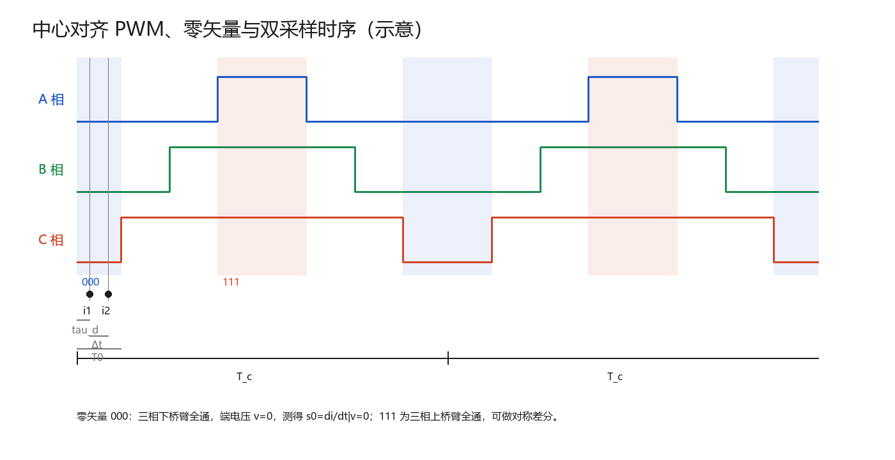
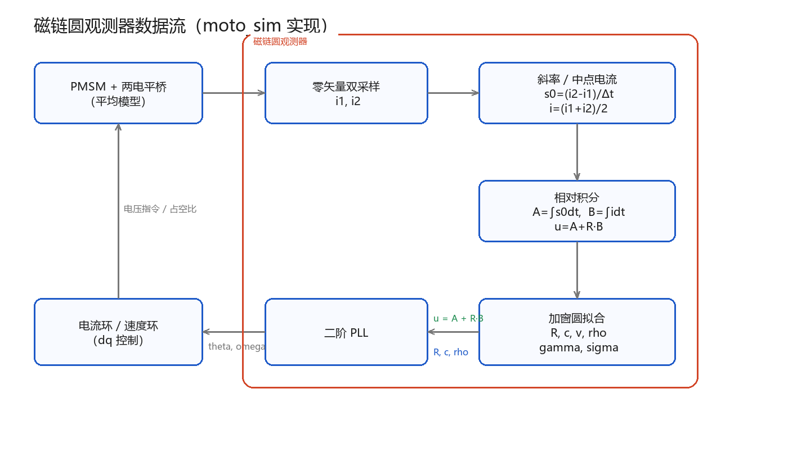
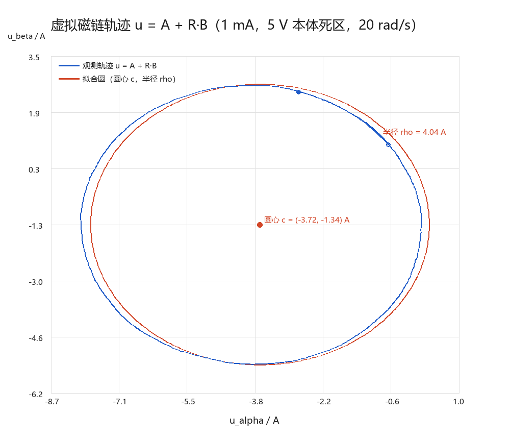
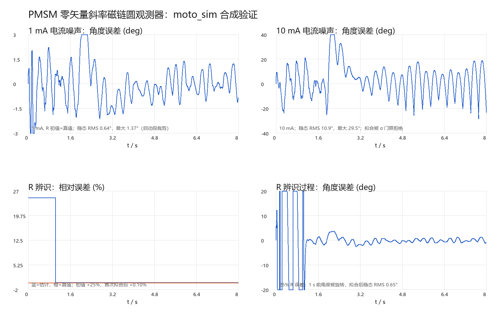
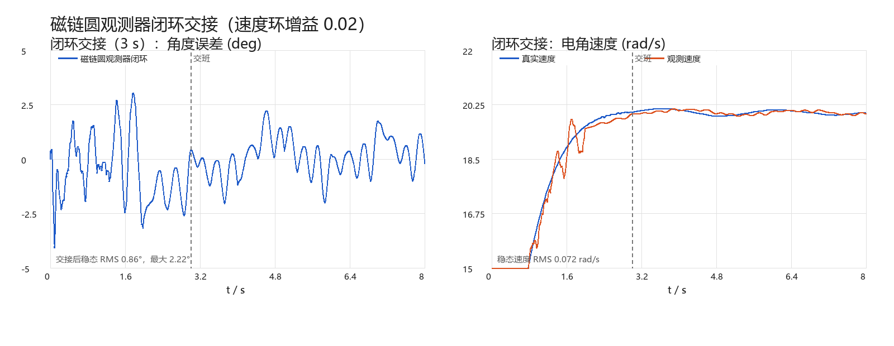

# 基于零矢量电流斜率积分的低速无传感器 PMSM 磁链/电阻观测器：moto_sim 实现、验证与问题分析

**摘要**——提出并实现一种不依赖输出电压重构的低速无传感器永磁同步电机（PMSM）转子磁链/电阻观测器。利用零矢量（下桥臂全通）期间电机端电压为零这一物理事实，对两次电流采样得到的电流斜率 $s_0$ 与中点电流 $i$ 分别积分，构造 $A(t)=\int s_0\,dt$ 、 $B(t)=\int i\,dt$ 。证明 $u=A+RB$ 精确落在以积分初值为圆心、以 $\rho=\psi_f/L$ 为半径的圆上；其中 $R=R_s/L$ 为待辨识标量， $R_s$ 为定子电阻， $L$ 为电感， $\psi_f$ 为永磁磁链。于是把“角度估计”化为“圆上相位提取”，把“电阻辨识”化为“带结构参数的圆拟合”。

本文的工作不是重复原论文的推导，而是把该算法完整移植到 `moto_sim` 的平均值电机仿真环境中，逐行说明代码实现，并用当前仿真的数据重新验证。主要工作与发现如下。

1. **实现层面**：新增 `FluxCircleObserver`，包含代数（Kåsa）初值扫描、几何圆拟合、变量投影、仿射圆心、Huber 鲁棒加权、Schur 补可观测性指标与二阶锁相环；在 `ObserverInput` 中增加零矢量斜率 `current_slope` 与采样间隔 `current_slope_dt` 两个接口。
2. **仿真层面**：`moto_sim` 的两电平功率桥是平均值模型，没有真实载波与开关状态，无法在零矢量内做两次真实电流采样。因此本文用电机 dq 微分方程在 $v_d=v_q=0$ 时的导数合成斜率，并按零矢量时长注入噪声；这是“传感器模型”，不是“真实 PWM 双采样”。这一点在全文反复强调。
3. **数据层面**：在风扇电机（ $p=5$ 、 $R_s=3.8\,\Omega$ 、 $L_d\approx L_q\approx9.9$ mH、 $\psi_f=0.04$ Wb）上，20 kHz 控制、16 kHz 载波、20 rad/s 电角速度（3.18 Hz）下：
   - 1 mA 电流噪声、5 V 本体平均死区时，稳态角度 RMS 为 **0.637°**，最大 1.372°；半径误差 −0.34%； $R$ 稳态不可辨识（ $\gamma\approx3\times10^{-3}$ ）。
   - $R$ 初值偏 **+25%** 时，速度斜坡中的首次圆拟合把它拉回 **+0.10%**，稳态角度 RMS 0.647°。
   - 10 mA 电流噪声时，稳态角度 RMS **10.878°**；这是该电机 $\rho\approx4.04$ A 下的物理信噪比限制，不是算法错误。
   - 3 s 交班闭环、速度环增益降到 0.02 时，闭环角度 RMS **0.859°**、速度 RMS 0.072 rad/s；原速度环增益 0.1 会与 PLL 相位滞后耦合失稳（角度 RMS 52.2°）。
4. **问题层面**：发现并处理了四个实现/理论问题：小弧数据会拟合出“巨大半径伪圆”；冻结 $R$ 时若沿用自由拟合的圆心/半径会差出 $(R_\mathrm{free}-R)B$ ； $\gamma$ 在相关噪声下会被高估，10 mA 时 0.05 门限会误更新 $R$ ；闭环速度环必须比 PLL 慢。并指出两处尚未解决的理论/工程问题：未实现 PAPER.md §5.4 的有效样本数修正；未实现真实 PWM 零矢量采样。

**关键词**——无传感器控制；永磁同步电机；零矢量电流斜率；磁链观测器；圆拟合；可辨识性；低速运行；moto_sim

---

## 符号表

| 符号 | 含义 | 单位 |
|---|---|---|
| $i_a,i_b,i_c$ | 三相定子电流 | A |
| $i_\alpha,i_\beta$ | 静止 $\alpha\beta$ 系电流 | A |
| $i_d,i_q$ | 转子 $dq$ 系电流 | A |
| $v_d,v_q$ | 转子 $dq$ 系电压 | V |
| $v_\alpha,v_\beta$ | 静止 $\alpha\beta$ 系电压 | V |
| $e$ | 反电势矢量 | V |
| $n$ | 转子磁链单位方向 $[\cos\theta_e,\sin\theta_e]^T$ | — |
| $J$ | 旋转 90° 矩阵（ $J^2=-I$ ） | — |
| $R_s$ | 定子电阻 | $\Omega$ |
| $L_d,L_q$ | $d$ 、 $q$ 轴电感 | H |
| $L$ | 等效标量电感，本文取 $(L_d+L_q)/2$ | H |
| $\psi_f$ | 永磁磁链 | Wb |
| $\lambda$ | 转子磁链矢量 $\psi_f n$ | Wb |
| $\theta_e,\theta_m$ | 电角度、机械角度 | rad |
| $\omega_e,\omega_m$ | 电角速度、机械角速度 | rad/s |
| $p$ | 极对数 | — |
| $T_e,T_L$ | 电磁转矩、负载转矩 | N·m |
| $J_m$ | 转动惯量 | kg·m² |
| $R$ | 待辨识标量 $R_s/L$ | s $^{-1}$ |
| $\rho$ | 圆半径 $\psi_f/L$ | A |
| $c$ | 圆心（积分初值） | A |
| $v$ | 圆心漂移速度 $dc/dt$ | A/s |
| $s_0$ | 零矢量电流斜率 $di/dt\,\vert_{v=0}$ | A/s |
| $A,B$ | $\int s_0dt$ 、 $\int idt$ | A, A·s |
| $u$ | $A+RB$ | A |
| $T_c,T_s,T_0$ | 载波周期、控制周期、零矢量时长 | s |
| $\Delta t$ | 零矢量内两次采样的间隔 | s |
| $\tau_d$ | 矢量切换后的稳定延时 | s |
| $w_k$ | 拟合权重 | — |
| $\sigma_i$ | 电流采样噪声标准差 | A |
| $\sigma_s$ | 斜率噪声标准差 | A/s |
| $\gamma$ | 可观测性指数 | — |
| $I_R$ | $R$ 的 Schur 补信息量 | — |
| $\zeta,\omega_n$ | PLL 阻尼比、自然频率 | —, rad/s |

---

## 1. 引言

低速无传感器控制的根本困难在于反电势 $\omega_e\psi_f$ 随转速趋于零：基于反电势的观测器在低速时信噪比按 $\omega_e$ 线性衰减。相比之下，转子磁链矢量的幅值恒为 $\psi_f$ ，是低速下不随转速衰减的角度载体；因此积分型磁链观测器天然更适合低速，代价是纯积分会漂移。

本文利用一种可测的“零电压电流斜率”绕开积分漂移的另一半来源——输出电压。在零矢量期间，电机端电压为零（理想开关、忽略器件压降），此时

$$
\dot i=-\frac{1}{L}\left(R_s i+e\right).
$$

其中， $\dot i$ 为 $\alpha\beta$ 系电流导数（A/s）， $R_s$ 为定子电阻（ $\Omega$ ）， $i$ 为 $\alpha\beta$ 系电流（A）， $e$ 为反电势矢量（V）， $L$ 为等效电感（H）。该式把“未知的施加电压”从方程中消去，只剩 $R_s$ 与 $e$ ；把该斜率积分，得到的是“虚拟磁链”而不是实际电流，从而使电阻项与反电势项分离成两个可辨识的系数。

核心恒等式在 §3 给出： $A+RB$ 恒在圆上。于是问题化为带结构参数的圆拟合问题。本文沿用圆拟合文献中的变量投影（variable projection）思想，把圆心与半径作为可消去的冗余参数，只对 $R$ 做一维寻优；同时用代数拟合给出全局初值以避免小半径伪解。

与已有工作相比，本文的贡献是**实现与验证**，而不是重新证明原论文的定理：

- 把算法完整移植到 `moto_sim`，给出逐拍数据流、拟合循环、门控与保护的代码级推导；
- 在平均值功率桥的限制下，给出“零矢量斜率传感器模型”的严格表达式，并明确它与真实 PWM 双采样的区别；
- 用当前仿真的数据给出 1 mA / 10 mA、开环 / 闭环、 $R$ 初值偏 25% 等工况的定量结果；
- 记录实现中真实遇到的数值与工程问题：小弧伪圆、冻结 $R$ 的几何不一致、 $\gamma$ 在相关噪声下虚高、速度环与 PLL 的耦合失稳。

---

## 2. moto_sim 的电机与控制模型

### 2.1 坐标变换

`moto_sim` 采用幅值不变的 Clarke 变换：

$$
i_\alpha=\frac{2i_a-i_b-i_c}{3},\qquad
i_\beta=\frac{i_b-i_c}{\sqrt3}.
$$

其中， $i_a,i_b,i_c$ 为三相电流（A）， $i_\alpha,i_\beta$ 为静止坐标系电流（A）。逆变换为

$$
i_a=i_\alpha,\qquad
i_b=-\frac12 i_\alpha+\frac{\sqrt3}{2}i_\beta,\qquad
i_c=-\frac12 i_\alpha-\frac{\sqrt3}{2}i_\beta.
$$

其中， $i_a,i_b,i_c$ 为三相电流（A）， $i_\alpha,i_\beta$ 为静止坐标系电流（A）。

Park 变换（从静止系到转子系）为

$$
\begin{bmatrix}x_d\\x_q\end{bmatrix}
=
\begin{bmatrix}\cos\theta_e & \sin\theta_e\\ -\sin\theta_e & \cos\theta_e\end{bmatrix}
\begin{bmatrix}x_\alpha\\x_\beta\end{bmatrix}.
$$

其中， $\theta_e$ 为电角度（rad）， $x$ 可代表电流、电压或磁链， $x_d,x_q$ 为转子系分量， $x_\alpha,x_\beta$ 为静止系分量。逆变换为

$$
\begin{bmatrix}x_\alpha\\x_\beta\end{bmatrix}
=
\begin{bmatrix}\cos\theta_e & -\sin\theta_e\\ \sin\theta_e & \cos\theta_e\end{bmatrix}
\begin{bmatrix}x_d\\x_q\end{bmatrix}.
$$

其中， $\theta_e$ 为电角度（rad），其余符号同上。代码中的 `rotate(v, theta)` 实现的就是上式右乘旋转矩阵。

### 2.2 PMSM 的 dq 电压方程

`moto_sim` 的 `PermanentMagnetSynchronousMotor` 采用如下 $dq$ 方程：

$$
L_d\frac{di_d}{dt}=v_d-R_s i_d+\omega_e L_q i_q,
$$


$$
L_q\frac{di_q}{dt}=v_q-R_s i_q-\omega_e\left(\psi_f+L_d i_d\right).
$$

其中， $L_d,L_q$ 为 $d,q$ 轴电感（H）， $i_d,i_q$ 为 $d,q$ 轴电流（A）， $v_d,v_q$ 为 $d,q$ 轴电压（V）， $R_s$ 为定子电阻（ $\Omega$ ）， $\omega_e$ 为电角速度（rad/s）， $\psi_f$ 为永磁磁链（Wb）。与标准 IPM 模型相比，这里已把永磁磁链项 $\omega_e\psi_f$ 与凸极项 $\omega_e L_d i_d$ 合并进 $q$ 轴反电势。

电磁转矩为

$$
T_e=\frac32 p\,i_q\left[\psi_f+(L_d-L_q)i_d\right].
$$

其中， $T_e$ 为电磁转矩（N·m）， $p$ 为极对数， $i_d,i_q$ 为 $d,q$ 轴电流（A）， $\psi_f$ 为永磁磁链（Wb）， $L_d,L_q$ 为 $d,q$ 轴电感（H）。对本文的风扇电机， $L_d\approx L_q$ ，凸极项很小，因此可近似为表贴式（SPM）。

机械方程为

$$
J_m\frac{d\omega_m}{dt}=T_e-T_L-B\omega_m,
$$

其中， $J_m$ 为转动惯量（kg·m²）， $\omega_m$ 为机械角速度（rad/s）， $T_e$ 为电磁转矩（N·m）， $T_L$ 为负载转矩（N·m）， $B$ 为粘性摩擦系数（N·m·s/rad）。`moto_sim` 的 `IdealMotionLoad` 还叠加了静摩擦 $T_\mathrm{static}\operatorname{sign}(\omega_m)$ ；本文的小信号分析只关心电角速度，故在公式中省略。电角度与机械角度的关系为

$$
\theta_e=p\theta_m,\qquad \omega_e=p\omega_m,
$$

其中， $\theta_e,\theta_m$ 为电角度、机械角度（rad）， $\omega_e,\omega_m$ 为电角速度、机械角速度（rad/s）， $p$ 为极对数。

### 2.3 两电平功率桥的平均值模型

`moto_sim` 的 `TwoLevelPowerBridge` 不模拟载波和开关状态，而是直接由占空比 $d_i$ 计算平均相电压：

$$
v_i=\operatorname{clamp}\left(d_i\frac{V_\mathrm{bus}}{2}+v_{\mathrm{dead},i},-\frac{V_\mathrm{bus}}{2},\frac{V_\mathrm{bus}}{2}\right),
$$

其中， $v_i$ 为第 $i$ 相平均电压（V）， $d_i\in[-1,1]$ 为第 $i$ 相占空比， $V_\mathrm{bus}$ 为母线电压（V）， $v_{\mathrm{dead},i}$ 为死区/器件压降的等效平均电压（V）， $\operatorname{clamp}(\cdot)$ 为限幅函数。

死区电压由电流方向查表得到：

$$
v_{\mathrm{dead},i}=V_\mathrm{bus}f_c\,g\!\left(i_i\right)s_\mathrm{dead},
$$

其中， $v_{\mathrm{dead},i}$ 为第 $i$ 相死区电压（V）， $V_\mathrm{bus}$ 为母线电压（V）， $f_c$ 为载波频率（Hz）， $g(\cdot)$ 为死区映射函数（本仿真为分段线性表）， $i_i$ 为第 $i$ 相电流（A）， $s_\mathrm{dead}$ 为死区倍率（本文默认 1.0，用于敏感性实验）。

**关键限制**：平均值模型没有载波、没有 000/111 开关状态、也没有零矢量时长。本文 §4.4 将用一个“传感器模型”合成零矢量斜率；这不是真实 PWM 双采样，而是当前仿真条件下唯一自洽的做法。

### 2.4 仿真参数

| 参数 | 数值 | 说明 |
|---|---|---|
| 极对数 $p$ | 5 | 风扇电机 |
| 定子电阻 $R_s$ | 3.8 $\Omega$ | |
| $L_d$ | $9.89\times10^{-3}$ H | |
| $L_q$ | $9.90\times10^{-3}$ H | 近似 SPM |
| 永磁磁链 $\psi_f$ | 0.04 Wb | |
| 转动惯量 $J_m$ | $10^{-2}$ kg·m² | |
| 母线电压 $V_\mathrm{bus}$ | $\approx310$ V | 整流后 |
| 载波频率 $f_c$ | 16 kHz | $T_c=62.5\,\mu$ s |
| 控制频率 $f_s$ | 20 kHz | $T_s=50\,\mu$ s |
| 电机积分步长 | 5 $\mu$ s | 无界面模式 |
| 电流采样噪声 $\sigma_i$ | 10 mA（默认）/1 mA（论文条件） | |
| 死区等效电压 | 约 5 V | 由 `zq10y_dead_mapping` 与母线/载波算出 |
| $R=R_s/L$ | 384.03 s $^{-1}$ | $L=(L_d+L_q)/2=9.895$ mH |
| $\rho=\psi_f/L$ | 4.042 A | |

---

## 3. 零矢量斜率与磁链圆恒等式

### 3.1 零矢量斜率

在 000 零矢量期间，三相下桥臂全通，电机端电压为零。由 §2.2 的 $dq$ 方程令 $v_d=v_q=0$ ：

$$
\frac{di_d}{dt}=\frac{-R_s i_d+\omega_e L_q i_q}{L_d},
$$

$$
\frac{di_q}{dt}=\frac{-R_s i_q-\omega_e\left(\psi_f+L_d i_d\right)}{L_q}.
$$

其中， $i_d,i_q$ 为 $d,q$ 轴电流（A）， $R_s$ 为定子电阻（ $\Omega$ ）， $L_d,L_q$ 为 $d,q$ 轴电感（H）， $\omega_e$ 为电角速度（rad/s）， $\psi_f$ 为永磁磁链（Wb）。上标 $(0)$ 在下文表示“零矢量”。

从 $dq$ 到 $\alpha\beta$ 的导数关系为

$$
\dot i_{\alpha\beta}
=R(\theta_e)\begin{bmatrix}\dot i_d\\ \dot i_q\end{bmatrix}
+\omega_e J i_{\alpha\beta},
$$

其中， $\dot i_{\alpha\beta}$ 为静止系电流导数（A/s）， $R(\theta_e)$ 为 2.1 节的旋转矩阵， $\dot i_d,\dot i_q$ 为转子系电流导数（A/s）， $\omega_e$ 为电角速度（rad/s）， $J=\begin{bmatrix}0&-1\\1&0\end{bmatrix}$ 为 90° 旋转矩阵， $i_{\alpha\beta}$ 为静止系电流（A）。第二项来自坐标系随转子旋转。

对 SPM（ $L_d=L_q=L$ ），把零矢量下的 $\dot i_d,\dot i_q$ 代入并整理：

$$
\left.\frac{di_{\alpha\beta}}{dt}\right|_{v=0}
=-\frac{1}{L}\left(R_s i_{\alpha\beta}+e\right),
\qquad e=\omega_e\psi_f J n,
$$

其中， $i_{\alpha\beta}$ 为静止系电流（A）， $R_s$ 为定子电阻（ $\Omega$ ）， $L$ 为等效电感（H）， $e$ 为反电势矢量（V）， $\omega_e$ 为电角速度（rad/s）， $\psi_f$ 为永磁磁链（Wb）， $J$ 为 90° 旋转矩阵， $n=[\cos\theta_e,\sin\theta_e]^T$ 为转子磁链单位方向。零矢量斜率式（§3.1）就是本文的测量方程：它把未知的施加电压消掉，只剩 $R_s$ 与 $e$ 。

### 3.2 双采样与中点配对

在每个零矢量区间内做两次电流采样：

$$
i_1=i(t_m-\Delta t/2),\qquad i_2=i(t_m+\Delta t/2),\qquad t_m=\tau_d+\Delta t/2,
$$

其中， $i_1,i_2$ 为两次采样电流（A）， $t_m$ 为两次采样的中点时刻（s）， $\Delta t$ 为两次采样的时间间隔（s）， $\tau_d$ 为矢量切换后的稳定延时（s）。斜率与电流取

$$
\hat s_0=\frac{i_2-i_1}{\Delta t},\qquad
\hat i=\frac{i_1+i_2}{2}.
$$

其中， $\hat s_0$ 为斜率估计（A/s）， $\hat i$ 为中点电流估计（A）， $i_1,i_2$ 为两次采样电流（A）， $\Delta t$ 为采样间隔（s）。

**中点配对是必须的。** 两个估计量必须对应同一时刻，否则模型 $A+RB$ 中出现

$$
R\cdot\left(\delta t\cdot\dot i\right)
$$

的错配项，其中 $R$ 为待辨识标量（s $^{-1}$ ）， $\delta t$ 为时间错配（s）， $\dot i$ 为电流导数（A/s）。该错配被 $R$ 放大（ $R\sim10^2$ s $^{-1}$ ），会直接把精度吃掉。用中点值 $\hat i$ 可把错配消到一阶。

### 3.3 双积分量与圆恒等式

定义

$$
A(t)=\int_0^t s_0(\tau)\,d\tau,\qquad
B(t)=\int_0^t i(\tau)\,d\tau,\qquad
u(t)=A(t)+R\,B(t).
$$

其中， $s_0$ 为零矢量斜率（A/s）， $i$ 为电流（A）， $A$ 为斜率积分（A）， $B$ 为电流积分（A·s）， $R$ 为待辨识标量（s $^{-1}$ ）， $u$ 为虚拟磁链（A）。

**定理 1（圆恒等式）**：令 $R=R_s/L$ ，则对任意电流与转速轨迹，

$$
u(t)=-\frac{1}{L}\left(\lambda(t)-\lambda(0)\right),
$$

其中， $u$ 为虚拟磁链（A）， $L$ 为等效电感（H）， $\lambda=\psi_f n$ 为转子磁链矢量（Wb）， $\lambda(0)$ 为初始磁链（Wb）。因此 $u$ 精确位于一个圆上，其圆心与半径分别为

$$
c=\frac{\lambda(0)}{L},\qquad \rho=\frac{\psi_f}{L}.
$$

其中， $c$ 为圆心（A）， $\lambda(0)$ 为初始磁链（Wb）， $L$ 为等效电感（H）， $\rho$ 为圆半径（A）， $\psi_f$ 为永磁磁链（Wb）。

**证明**：把零矢量斜率式（§3.1）代入：

$$
A+RB=\int\left[-\frac{R_s i+e}{L}+R\,i\right]dt
=-\frac{1}{L}\int e\,dt+\left(R-\frac{R_s}{L}\right)B.
$$

其中， $A,B$ 为双积分（A, A·s）， $R_s$ 为定子电阻（ $\Omega$ ）， $L$ 为电感（H）， $i$ 为电流（A）， $e$ 为反电势（V）， $R$ 为待辨识标量（s $^{-1}$ ）。取 $R=R_s/L$ 时第二项消失；又因为 $\dot\lambda=e$ ，故

$$
A+RB=-\frac{1}{L}\int_0^t e\,d\tau=-\frac{1}{L}\left(\lambda(t)-\lambda(0)\right).
$$

其中， $A,B$ 为双积分（A, A·s）， $R$ 为待辨识标量（s $^{-1}$ ）， $L$ 为电感（H）， $e$ 为反电势（V）， $\lambda$ 为转子磁链（Wb）。证毕。 $\square$

由圆恒等式与 $u-c=-\rho n$ 得角度：

$$
\theta_e=\operatorname{atan2}\left(-(u_y-c_y),\;-(u_x-c_x)\right),
$$

其中， $\theta_e$ 为电角度（rad）， $u_x,u_y$ 为虚拟磁链的 $\alpha,\beta$ 分量（A）， $c_x,c_y$ 为圆心分量（A）， $\operatorname{atan2}(\cdot,\cdot)$ 为四象限反正切。注意负号： $u-c=-\rho n$ ，所以 $n=-(u-c)/\rho$ 。

### 3.4 恒等式的三个要点

1. **不要求稳态**。 $\lambda$ 只要满足 $\dot\lambda=e$ ，则对任意 $\omega_e(t)$ 、任意 $i(t)$ 成立；转速变化只改变点在圆上的分布密度，不改变圆本身。
2. **$L$ 被完全消去**。可观测量是 $R_s/L$ 与 $\psi_f/L$ 两个比值； $L$ 作为公共尺度不出现。
3. **角度信噪比不随转速衰减**。因为 $|u-c|=\rho$ 恒定，角度噪声 $\sigma_\theta=\sigma_u/\rho$ ，其中 $\sigma_u$ 只由积分噪声决定，与 $\omega_e$ 至多呈 $\omega_e^{-1/2}$ 关系。这是相对反电势法（ $\propto\omega_e^{-1}$ ）的本质优势。

---

## 4. 采样结构、噪声与 moto_sim 的斜率传感器模型

### 4.1 噪声的异方差性

设两次采样噪声独立、方差 $\sigma_i^2$ ，则

$$
\operatorname{Var}(\hat s_0)=\frac{2\sigma_i^2}{\Delta t^2},\qquad
\operatorname{Var}(\hat i)=\frac{\sigma_i^2}{2},\qquad
\operatorname{Cov}(\hat s_0,\hat i)=0.
$$

其中， $\hat s_0$ 为斜率估计（A/s）， $\hat i$ 为中点电流估计（A）， $\sigma_i$ 为电流采样噪声标准差（A）， $\Delta t$ 为采样间隔（s）， $\operatorname{Var}(\cdot)$ 为方差， $\operatorname{Cov}(\cdot,\cdot)$ 为协方差。

斜率噪声与 $\Delta t$ 成反比——这是本方法“只在低调制比有效”的数学根源。零矢量时长近似为

$$
T_0\approx T_c(1-m),
$$

其中， $T_0$ 为零矢量时长（s）， $T_c$ 为载波周期（s）， $m$ 为调制度（0 到 1）。可用的采样间隔受

$$
\Delta t\le T_0-\tau_d
$$

约束，其中 $\Delta t$ 为采样间隔（s）， $T_0$ 为零矢量时长（s）， $\tau_d$ 为稳定延时（s）。因此

$$
\sigma_s\propto\frac{\sigma_i}{T_c(1-m)-\tau_d},
$$

其中， $\sigma_s$ 为斜率噪声标准差（A/s）， $\sigma_i$ 为电流噪声标准差（A）， $T_c$ 为载波周期（s）， $m$ 为调制度， $\tau_d$ 为稳定延时（s）。低调制比（低速）时 $T_0\to T_c$ ，信噪比最好；高调制比时 $T_0$ 迅速缩短，斜率测量退化。

因此窗口拟合必须采用加权最小二乘，权重取 $\hat s_0$ 的逆方差：

$$
w_k=\frac{\Delta t_k^2}{2\sigma_i^2},
$$

其中， $w_k$ 为第 $k$ 个样本的权重， $\Delta t_k$ 为该样本的采样间隔（s）， $\sigma_i$ 为电流噪声标准差（A）。长零矢量样本自动获得更高权重，无需人为调度。

### 4.2 零矢量时长的 moto_sim 计算

平均值桥没有载波，但 `moto_sim` 仍可由占空比估计“如果存在中心对齐 PWM，零矢量占多大比例”。对三相占空比 $d_a,d_b,d_c$ ，中心对齐 PWM 的全低（000）区间由最大占空比决定，全高（111）区间由最小占空比决定：

$$
f_{000}=\frac{1-\max_i d_i}{2},\qquad
f_{111}=\frac{1+\min_i d_i}{2},
$$

其中， $f_{000}$ 为 000 零矢量在一个载波周期内的占比， $f_{111}$ 为 111 零矢量的占比， $d_i\in[-1,1]$ 为第 $i$ 相占空比。本文把两者合并为“可用零矢量占比”

$$
f_0=1-\frac{1}{2}\left(\max_i d_i-\min_i d_i\right),
$$

其中， $f_0$ 为零矢量总占比， $d_i$ 为第 $i$ 相占空比。于是

$$
\Delta t_\mathrm{zv}=f_0T_c-\tau_d,
$$

其中， $\Delta t_\mathrm{zv}$ 为可用采样间隔（s）， $f_0$ 为零矢量占比， $T_c$ 为载波周期（s）， $\tau_d$ 为稳定延时（s）。在 `moto_sim` 中取 $\tau_d=3\,\mu$ s；当 $\Delta t_\mathrm{zv}<1\,\mu$ s 时，本拍斜率标记为不可用。



图 1 是中心对齐 PWM 的示意：图中三相高电平占空比 $h_a=0.24$ 、 $h_b=0.50$ 、 $h_c=0.76$ （等效双极性 $d_i=2h_i-1$ ）。全低（000）区间出现在载波周期的两端，宽度由 $\max_i d_i$ 决定；全高（111）区间出现在中间，宽度由 $\min_i d_i$ 决定。第一次采样在矢量切换后延时 $\tau_d$ ，第二次再延时 $\Delta t$ ；两次采样的中点是斜率与电流的共同有效时刻。图中 000 区间内的 $i_1,i_2$ 就是本文 `current_slope` 的来源（真实 PWM 时应如此；本文仿真用 §4.4 的 ODE 合成）。

### 4.3 斜率噪声注入

由 §4.1，斜率噪声标准差为

$$
\sigma_s=\frac{\sqrt2\,\sigma_i}{\Delta t_\mathrm{zv}},
$$

其中， $\sigma_s$ 为斜率噪声标准差（A/s）， $\sigma_i$ 为电流采样噪声标准差（A）， $\Delta t_\mathrm{zv}$ 为可用采样间隔（s）。`moto_sim` 对三相斜率分别注入独立高斯噪声：

$$
s_{0,i}^\mathrm{meas}=s_{0,i}^\mathrm{true}+\sigma_s\,\xi_i,
$$

其中， $s_{0,i}^\mathrm{meas}$ 为第 $i$ 相测量斜率（A/s）， $s_{0,i}^\mathrm{true}$ 为真实零矢量斜率（A/s）， $\sigma_s$ 为斜率噪声标准差（A/s）， $\xi_i\sim\mathcal N(0,1)$ 为标准正态随机数。

### 4.4 moto_sim 的零矢量斜率传感器模型

由于平均值桥不能提供真实零矢量，本文用电机 dq 微分方程在 $v_d=v_q=0$ 时的导数合成斜率。由 §3.1：

$$
\dot i_d^{(0)}=\frac{-R_s i_d+\omega_e L_q i_q}{L_d},\qquad
\dot i_q^{(0)}=\frac{-R_s i_q-\omega_e\left(\psi_f+L_d i_d\right)}{L_q}.
$$

其中， $\dot i_d^{(0)},\dot i_q^{(0)}$ 为零矢量下的 $d,q$ 轴电流导数（A/s）， $i_d,i_q$ 为 $d,q$ 轴电流（A）， $R_s$ 为定子电阻（ $\Omega$ ）， $L_d,L_q$ 为 $d,q$ 轴电感（H）， $\omega_e$ 为电角速度（rad/s）， $\psi_f$ 为永磁磁链（Wb）。

再转到静止系：

$$
s_{0,\alpha\beta}=R(\theta_e)\begin{bmatrix}\dot i_d^{(0)}\\ \dot i_q^{(0)}\end{bmatrix}+\omega_e J i_{\alpha\beta},
$$

其中， $s_{0,\alpha\beta}$ 为静止系零矢量斜率（A/s）， $R(\theta_e)$ 为旋转矩阵， $\dot i_d^{(0)},\dot i_q^{(0)}$ 为 $d,q$ 轴零矢量导数（A/s）， $\omega_e$ 为电角速度（rad/s）， $J$ 为 90° 旋转矩阵， $i_{\alpha\beta}$ 为静止系电流（A）。最后用逆 Clarke 变换得到三相斜率并注入噪声。注意：合成斜率使用完整的 $L_d,L_q$ ，而观测器使用标量 $L=(L_d+L_q)/2$ ；本文风扇电机两者相差约 0.1%，对结果的影响可忽略，但内置式电机的凸极会让这个近似失效（§11.7）。

**必须强调**：零矢量斜率传感器模型（§4.4）使用的是电机状态 $(i_d,i_q,\theta_e,\omega_e)$ ，不是从真实 PWM 波形中测得的 $i_1,i_2$ 。因此本文的验证是“算法 + 传感器模型”的闭环仿真，不是“算法 + 真实开关纹波”的硬件在环。§12 会详细讨论这一局限。

### 4.5 相关噪声与有效样本数

严格地说， $\hat s_0$ 的噪声经积分后是随机游走，相邻 $u_k$ 的误差高度相关。若直接按独立样本计算，方差会被严重低估。相关时间由漂移抑制的时间常数决定，因此有效独立样本数约为

$$
N_\mathrm{eff}\approx\frac{T_\mathrm{win}}{\tau_\mathrm{corr}},
$$

其中， $N_\mathrm{eff}$ 为有效独立样本数， $T_\mathrm{win}$ 为窗口长度（s）， $\tau_\mathrm{corr}$ 为噪声相关时间（s）。工程上应把 $N_\mathrm{eff}$ （或直接用 $\operatorname{Var}(\hat R)$ ）作为输出量之一，供上层判断估计可信度，而不应把它隐藏在内部。

本文**尚未实现**这一修正。这正是 10 mA 下 $\gamma$ 被高估、0.05 门限会误更新 $R$ 的原因（§10.4）。当前用 `sigma/radius < 2%` 的硬门限作为补充保护。

---

## 5. 可辨识性分析

### 5.1 稳态下的连续对称性

设电流与磁链均为恒速正弦：

$$
i=\operatorname{Re}\left[I e^{j\theta_e}\right],\qquad
\lambda=\psi_f e^{j\theta_e},
$$

其中， $i$ 为复电流（A）， $I=i_d+ji_q$ 为电流相量（A）， $\theta_e$ 为电角度（rad）， $\lambda$ 为转子磁链（Wb）， $\psi_f$ 为永磁磁链（Wb）， $\operatorname{Re}[\cdot]$ 为取实部。则

$$
B(t)=\int i\,dt=\operatorname{Re}\left[\frac{I}{j\omega_e}e^{j\theta_e}\right]+B_0,
$$

其中， $B$ 为电流积分（A·s）， $I$ 为电流相量（A）， $\omega_e$ 为电角速度（rad/s）， $\theta_e$ 为电角度（rad）， $B_0$ 为积分常数（A·s）。

若估计值为 $\hat R=R+\Delta R$ ，则

$$
u_\Delta=u+\Delta R\,B
=-\frac{1}{L}\left(\psi_f+j\frac{L\Delta R\,I}{\omega_e}\right)e^{j\theta_e}+\text{const},
$$

其中， $u_\Delta$ 为错误 $R$ 下的虚拟磁链（A）， $u$ 为真实虚拟磁链（A）， $\Delta R$ 为电阻标量误差（s $^{-1}$ ）， $B$ 为电流积分（A·s）， $L$ 为电感（H）， $\psi_f$ 为永磁磁链（Wb）， $I$ 为电流相量（A）， $\omega_e$ 为电角速度（rad/s）， $\theta_e$ 为电角度（rad）， $\text{const}$ 为常矢量（A）。

**定理 2（不可辨识性）**：记 $\psi_\mathrm{eff}=\psi_f+j\Delta R_\Omega I/\omega_e$ ，其中 $\Delta R_\Omega=L\Delta R$ 为欧姆单位的电阻误差（ $\Omega$ ）。则 $u_\Delta$ 与 $u$ 只相差一个复常数乘子。由于圆的模型 $\{c,\rho\}$ 不含相位参数，而相位变化对应同一点集的不同参数化，该乘子被 $(c,\rho)$ 完全吸收。

**推论**：在恒定转速、恒定 $i_{dq}$ 、无偏置的稳态下，任何 $R$ 都使 $A+RB$ 成为严格圆；几何代价函数关于 $R$ 恒为零， $R$ 严格不可辨识。

这不是数值问题，也不是算法选择问题，而是模型的 1 参数连续对称群。任何“用圆拟合去标定 $R$ ”的尝试在稳态必然失败。

### 5.2 敏感性的两条正交通道

把复乘子展开：

$$
\frac{\psi_\mathrm{eff}}{\psi_f}
=1+j\frac{\Delta R_\Omega I}{\omega_e\psi_f}
=1+j\frac{\Delta R_\Omega(i_d+ji_q)}{\omega_e\psi_f}.
$$

其中， $\psi_\mathrm{eff}$ 为等效磁链（Wb）， $\psi_f$ 为永磁磁链（Wb）， $\Delta R_\Omega=L\Delta R$ 为欧姆单位电阻误差（ $\Omega$ ）， $I=i_d+ji_q$ 为电流相量（A）， $\omega_e$ 为电角速度（rad/s）， $i_d,i_q$ 为 $d,q$ 轴电流（A）。实部为 $1-\Delta R_\Omega i_q/(\omega_e\psi_f)$ ，虚部为 $\Delta R_\Omega i_d/(\omega_e\psi_f)$ 。对小误差，

$$
\delta\theta\approx\frac{\Delta R_\Omega i_d}{\omega_e\psi_f}
=\frac{\Delta R\,i_d}{\omega_e\rho},
$$

$$
\frac{\delta\rho}{\rho}\approx-\frac{\Delta R_\Omega i_q}{\omega_e\psi_f}
=-\frac{\Delta R\,i_q}{\omega_e\rho}.
$$

其中， $\delta\theta$ 为角度误差（rad）， $\Delta R_\Omega=L\Delta R$ 为欧姆单位电阻误差（ $\Omega$ ）， $i_d,i_q$ 为 $d,q$ 轴电流（A）， $\omega_e$ 为电角速度（rad/s）， $\psi_f$ 为永磁磁链（Wb）， $\Delta R$ 为电阻标量误差（s $^{-1}$ ）， $\rho=\psi_f/L$ 为圆半径（A）。推导用到了 $\arg(1+jx)\approx x$ 与 $|1+jx|\approx1$ 。

两条通道正交且含义明确：

- **$d$ 轴电流把 $R$ 误差变成角度偏置**。这是低速最危险的一项，且 $\propto1/\omega_e$ 。
- **$q$ 轴电流把 $R$ 误差变成磁链幅值误差**。它不直接错角度，但会错转矩标定与 MTPA 工作点。

**精度要求**：要求 $|\delta\theta|\le\delta\theta_{\max}$ ：

$$
\frac{\Delta R}{R}\le
\frac{\delta\theta_{\max}\,\omega_e\,\psi_f}{R_s\,i_d},
$$

其中， $\Delta R/R$ 为相对电阻误差， $\delta\theta_{\max}$ 为允许角度误差（rad）， $\omega_e$ 为电角速度（rad/s）， $\psi_f$ 为永磁磁链（Wb）， $R_s$ 为定子电阻（ $\Omega$ ）， $i_d$ 为 $d$ 轴电流（A）。

对本文风扇电机（ $R_s=3.8\,\Omega$ 、 $\psi_f=0.04$ Wb、 $\rho=4.042$ A、 $R=384.03$ s $^{-1}$ ），取 $i_d=i_q=1$ A、 $\Delta R/R=1\%$ （即 $\Delta R=3.84$ s $^{-1}$ ，小信号）：

| 电频率 | $\omega_e$ (rad/s) | $\delta\theta$ | $\delta\rho/\rho$ |
|---|---|---|---|
| 1 Hz | 6.283 | 8.66° | −15.1% |
| 3.18 Hz | 20.0 | 2.72° | −4.75% |
| 10 Hz | 62.83 | 0.866° | −1.51% |

其中， $\omega_e$ 为电角速度（rad/s）， $\delta\theta$ 为角度误差（rad）， $\delta\rho/\rho$ 为半径相对误差，表值由 §5.2 的两条敏感通道式（小信号线性化）计算。该表说明：**低速下 $R$ 误差的幅值通道非常敏感**；本文风扇电机在 MTPA 下 $i_d\approx0$ （凸极极小），角度通道较弱，但半径通道仍然显著。若 $\Delta R/R=10\%$ ，1 Hz 时 $x=\Delta R i_q/(\omega_e\rho)\approx1.5$ ，线性化已失效，必须用上面的精确复乘子；此时 3.18 Hz 的精确相位约 42°、半径约 −29%。这正是 25% $R$ 初值实验里“拟合前角度/半径都不对、拟合后恢复”的原因。

精度要求表（风扇电机， $i_d=1$ A）：

| 电频率 | $\omega_e\psi_f$ (V) | $\Delta R/R$ @ 5° | @ 10° |
|---|---|---|---|
| 1 Hz | 0.251 | 0.58% | 1.16% |
| 3.18 Hz | 0.80 | 1.84% | 3.68% |
| 10 Hz | 2.51 | 5.8% | 11.6% |

其中， $\omega_e\psi_f$ 为反电势幅值（V）， $\Delta R/R$ 为允许的相对电阻误差，5°/10° 为允许角度误差。结论：**1 Hz 以下要求 $R$ 精度在百分之一量级**，这是必须做在线辨识的根本原因。

### 5.3 可观测性指数

$R$ 对几何的唯一作用是把轨迹沿 $\Delta R\,B(t)$ 移动，而圆拟合只对**径向**分量敏感。记

$$
n_k=\frac{u_k-c}{\rho},\qquad s_k=n_k\cdot B_k,
$$

其中， $n_k$ 为第 $k$ 个点的单位法向， $u_k$ 为第 $k$ 个虚拟磁链（A）， $c$ 为圆心（A）， $\rho$ 为圆半径（A）， $s_k$ 为 $B_k$ 的径向投影（A·s）， $B_k$ 为第 $k$ 个电流积分（A·s）， $\cdot$ 为点积。 $R$ 的一阶信息为 Schur 补

$$
I_R=\min_{\kappa\in\mathbb R^2}\sum_k w_k
\left(s_k-\bar s-\kappa\cdot(n_k-\bar n)\right)^2,
$$

其中， $I_R$ 为 $R$ 的信息量， $\kappa$ 为二维回归系数（A·s）， $w_k$ 为权重， $s_k$ 为径向投影（A·s）， $\bar s$ 为加权均值（A·s）， $n_k$ 为单位法向， $\bar n$ 为加权均值， $\cdot$ 为点积。等价地，

$$
\gamma=\frac{I_R}{\sum_k w_k\|B_k-\bar B\|^2}\in[0,1],
$$

其中， $\gamma$ 为可观测性指数， $I_R$ 为 $R$ 的信息量， $w_k$ 为权重， $B_k$ 为电流积分（A·s）， $\bar B$ 为加权均值（A·s）。 $\gamma$ 是工程上真正需要的量：它直接回答“当前窗口能不能定 $R$ ”，而不是让滤波器在不可观测方向上输出噪声。

在恒定工况下可解析地算出

$$
B\approx\frac{i_q}{\omega_e}n-\frac{i_d}{\omega_e}Jn+B_0,
$$

其中， $B$ 为电流积分（A·s）， $i_q,i_d$ 为 $q,d$ 轴电流（A）， $\omega_e$ 为电角速度（rad/s）， $n$ 为转子磁链单位方向， $J$ 为 90° 旋转矩阵， $B_0$ 为积分常数（A·s）。故

$$
n\cdot B=\frac{i_q}{\omega_e}+B_0\cdot n-\bar s,
$$

其中， $n$ 为单位法向， $B$ 为电流积分（A·s）， $i_q$ 为 $q$ 轴电流（A）， $\omega_e$ 为电角速度（rad/s）， $B_0$ 为积分常数（A·s）， $\bar s$ 为径向投影均值（A·s）。后两项都在 $\{1,n\}$ 张成的冗余空间内，于是

$$
\gamma\approx
\frac{\operatorname{Var}_{\perp}\left(i_q/\omega_e\right)}
{\operatorname{Var}\left(B\right)},
$$

其中， $\gamma$ 为可观测性指数， $\operatorname{Var}_{\perp}(\cdot)$ 为扣除 $\{1,n\}$ 方向后的方差， $i_q$ 为 $q$ 轴电流（A）， $\omega_e$ 为电角速度（rad/s）， $\operatorname{Var}(B)$ 为电流积分的方差（A²·s²）。

**$R$ 的可观测性正比于 $i_q/\omega_e$ 在窗口内的变化幅度。** 恒定负载、恒定转速时 $\gamma=0$ ；负载或转速变化时 $\gamma>0$ 。本文仿真中：

- 稳态 20 rad/s、1 mA 时 $\gamma\approx3.0\times10^{-3}$ ，远低于门限， $R$ 冻结；
- 速度斜坡段 $\gamma\approx3.3\times10^{-2}$ ，足以把 +25% 的 $R$ 初值拉回 +0.10%；
- 10 mA 时自由拟合的 $\gamma$ 被相关噪声抬高到 0.14，0.05 门限会误接受一个 −6% 的 $R$ （§10.4）。

### 5.4 停机退化：电阻初值

$\omega_e=0\Rightarrow e=0\Rightarrow A=-RB$ 逐点成立。圆退化为点， $R$ 化为一次线性回归：

$$
\hat R=-\frac{A\cdot B}{B\cdot B},
$$

其中， $\hat R$ 为电阻标量估计（s $^{-1}$ ）， $A$ 为斜率积分（A）， $B$ 为电流积分（A·s）， $\cdot$ 为点积。若存在器件压降 $V_d$ （随电流方向变号），单点给出 $R+V_d/(Li)$ ；用两个电流幅值 × 两个极性共四次测量即可联立解出 $R_s/L$ 与 $V_d$ 。这是上电自整定的标准做法。

本文仿真在零速时电流为零，没有做停机标定； $R$ 的初值直接取铭牌值（384.03 s $^{-1}$ ），在 25% 实验中故意取 1.25 倍作为初值。实际系统应利用 ALIGN 阶段的直流电流做停机回归式（§5.4）的回归，或至少用铭牌值并把 $\gamma$ 门限设保守。

---

## 6. 估计器：从圆拟合到代码

### 6.1 代价函数

对窗内 $N$ 个观测 $(A_k,B_k)$ ，定义

$$
u_k(R)=A_k+R\,B_k,
$$

其中， $u_k$ 为第 $k$ 个虚拟磁链（A）， $A_k$ 为斜率积分（A）， $R$ 为待辨识标量（s $^{-1}$ ）， $B_k$ 为电流积分（A·s）。目标是

$$
\min_{R,\,c,\,\rho}\ \sum_k w_k
\left(\left\|u_k(R)-c\right\|-\rho\right)^2,
$$

其中， $R$ 为待辨识标量（s $^{-1}$ ）， $c$ 为圆心（A）， $\rho$ 为圆半径（A）， $w_k$ 为权重， $u_k$ 为虚拟磁链（A）， $\|\cdot\|$ 为欧氏范数。其中 $\rho$ 可解析消去（等于加权平均距离）， $c$ 给定 $R$ 时由二维 Gauss–Newton 求得。外层只剩一维。

### 6.2 代数（Kåsa）拟合

对固定 $R$ ，Kåsa 拟合最小化代数距离：

$$
\min_{D,E,F}\ \sum_k w_k
\left(\|u_k\|^2+D u_{kx}+E u_{ky}+F\right)^2,
$$

其中， $D,E,F$ 为代数圆参数， $w_k$ 为权重， $u_{kx},u_{ky}$ 为 $u_k$ 的 $\alpha,\beta$ 分量（A）， $\|\cdot\|$ 为欧氏范数。它对 $(D,E,F)$ 是线性的，一次 $3\times3$ 求解即可；圆心为

$$
c_x=-\frac{D}{2},\qquad c_y=-\frac{E}{2},
$$

其中， $c_x,c_y$ 为圆心分量（A）， $D,E$ 为代数圆参数。半径可写成 $\sqrt{(D^2+E^2)/4-F}$ ，但代码只用圆心和代价值。

代数拟合有已知偏差（小弧段会压缩半径），所以它只当“盆地探测器”：代数代价在真 $R$ 处恒等于零（点恰在圆上），伪解处不为零；在 $R$ 的对数网格上扫 60 点取最小，即可锁定正确盆地。

### 6.3 仿射圆心

积分漂移（采样偏置、器件压降的直流分量、电流偏置）在 $u$ 上表现为**线性斜坡**，而非常数。若用泄漏积分器抑制漂移，会把圆压成螺旋并引入

$$
\varphi_\mathrm{lag}=\arctan\left(\frac{k_d}{\omega_e}\right),
\qquad
A_\mathrm{att}=\frac{\omega_e}{\sqrt{\omega_e^2+k_d^2}}
$$

的固定相位滞后与幅值衰减。其中， $\varphi_\mathrm{lag}$ 为相位滞后（rad）， $k_d$ 为泄漏系数（s $^{-1}$ ）， $\omega_e$ 为电角速度（rad/s）， $A_\mathrm{att}$ 为幅值衰减系数。低速时需 $k_d\ll\omega_e$ 才压得住失真，于是漂移抑制又太慢——两难。

本文改用仿射中心模型：

$$
u_k(R)=c_0+v\,(t_k-\bar t)+\rho\,n_k,\qquad \|n_k\|=1,
$$

其中， $u_k$ 为第 $k$ 个虚拟磁链（A）， $R$ 为待辨识标量（s $^{-1}$ ）， $c_0$ 为参考时刻 $\bar t$ 的圆心（A）， $v$ 为圆心漂移速度（A/s）， $t_k$ 为第 $k$ 个样本时刻（s）， $\bar t$ 为时间加权均值（s）， $\rho$ 为半径（A）， $n_k$ 为单位法向， $\|\cdot\|$ 为欧氏范数。 $v\in\mathbb R^2$ 直接吸收积分偏置，不改变交流分量。代价函数对 $(R,c_0,v)$ 共 5 个参数做 Gauss–Newton， $\rho$ 仍解析消去。

**重要性质**：恒定的电流采样偏置与恒定的器件压降直流分量都只产生 $u$ 的线性斜坡，被 $v$ 精确吸收，因此它们对**角度**无害。但代价是：当电流含直流分量时， $R$ 误差也产生斜坡，与 $v$ 混淆；此时 $R$ 不可辨识，必须依赖 §5.4 或工况回归。

### 6.4 变量投影：半径消去与雅可比

给定 $(R,c,v)$ ，最优半径为加权平均距离：

$$
\rho=\frac{\sum_k w_k d_k}{\sum_k w_k},
\qquad
d_k=\left\|u_k-c-v(t_k-\bar t)\right\|,
$$

其中， $\rho$ 为半径（A）， $w_k$ 为权重， $d_k$ 为第 $k$ 个点到圆心的距离（A）， $u_k$ 为虚拟磁链（A）， $c$ 为圆心（A）， $v$ 为圆心漂移（A/s）， $t_k$ 为样本时刻（s）， $\bar t$ 为时间均值（s）， $\|\cdot\|$ 为欧氏范数。残差

$$
e_k=d_k-\rho,
$$

其中， $e_k$ 为径向残差（A）， $d_k$ 为距离（A）， $\rho$ 为半径（A）。消去 $\rho$ 后满足 $\sum_k w_k e_k=0$ ，这正是后面“去均值”操作的来源。

记 $n_k=(u_k-c-v\tau_k)/d_k$ 、 $\tau_k=t_k-\bar t$ ，则

$$
\frac{\partial d_k}{\partial R}=n_k\cdot B_k,\qquad
\frac{\partial d_k}{\partial c}=-n_k,\qquad
\frac{\partial d_k}{\partial v}=-\tau_k n_k,
$$

其中， $d_k$ 为距离（A）， $R$ 为待辨识标量（s $^{-1}$ ）， $n_k$ 为单位法向， $B_k$ 为电流积分（A·s）， $c$ 为圆心（A）， $v$ 为圆心漂移（A/s）， $\tau_k$ 为相对时间（s）， $\cdot$ 为点积。半径的雅可比列是常数 $-1$ ；在法方程里消去这一列，等价于把每一列和残差都按权重去均值：

$$
H_\mathrm{eff}=H-\frac{h_\rho h_\rho^T}{\sum_k w_k},
$$

其中， $H_\mathrm{eff}$ 为消去半径后的法矩阵， $H$ 为原始法矩阵， $h_\rho$ 为半径列与其他列的交叉项， $w_k$ 为权重。这就是变量投影（variable projection）在此处的具体形式，代码中体现为 `jr[k][i] - mean[i]`。

### 6.5 Gauss–Newton、Levenberg 与信赖域

法方程为

$$
H=\sum_k w_k\,j_k j_k^T,\qquad
g=\sum_k w_k\,j_k e_k,\qquad
(H+\lambda I)\,\Delta=-g,
$$

其中， $H$ 为 $5\times5$ 法矩阵， $w_k$ 为权重， $j_k$ 为第 $k$ 个雅可比行向量， $g$ 为梯度， $e_k$ 为径向残差（A）， $\lambda$ 为 Levenberg 阻尼， $I$ 为单位矩阵， $\Delta$ 为参数增量。代码取

$$
\lambda_i=10^{-9}\left(|H_{ii}|+1\right),
$$

其中， $\lambda_i$ 为第 $i$ 个对角阻尼， $H_{ii}$ 为法矩阵对角元；这是相对量级的对角加载，在不可辨识方向上把步长压住，而不是让它发散。

信赖域限制单步幅度：

$$
|\Delta R|\le 0.5|R|+1,\qquad
\|\Delta c\|\le 0.5\sigma+10^{-9},
$$

其中， $\Delta R$ 为电阻步长（s $^{-1}$ ）， $R$ 为当前电阻（s $^{-1}$ ）， $\Delta c$ 为圆心步长（A）， $\sigma$ 为径向残差尺度（A）。若整步使代价下降则接受；否则折半再试；仍不降则停止。收敛判据为

$$
\sum_i|\Delta_i|<10^{-13},
$$

其中， $\Delta_i$ 为第 $i$ 个参数增量，阈值 $10^{-13}$ 为拟合器配置 `eps`。

### 6.6 Huber 鲁棒加权与退火

径向残差上做 Huber IRLS：

$$
w_k^\mathrm{rob}=
\begin{cases}
1, & |e_k|\le k_\sigma\sigma,\\
\dfrac{k_\sigma\sigma}{|e_k|}, & |e_k|>k_\sigma\sigma,
\end{cases}
$$

其中， $w_k^\mathrm{rob}$ 为鲁棒权重， $e_k$ 为径向残差（A）， $k_\sigma=1.345$ 为 Huber 阈值（对应高斯噪声下 95% 渐近效率）， $\sigma$ 为当前残差尺度（A）。关键在于**鲁棒权重必须退火**：若初值误差较大（如 25%），早期残差由模型误差主导，Huber 会把携带 $R$ 信息的样本当作野值压制，导致收敛到有偏解。实现上取前 3 次迭代为纯最小二乘，之后才启用 Huber。

### 6.7 多峰性与小弧病态

数值实验显示：当 $R$ 偏离真值约 10% 时，轨迹上会出现一个半径明显偏小（约真实值的 0.5 倍）的伪圆，构成一个宽而浅的局部极小；而真解是一个窄而深的谷。仅靠单一初值的局部迭代会稳定地落入伪解。

对策是“代数扫描 + 几何精化”：在 $R$ 的对数网格上（60 点，覆盖 $[0.3,3]\hat R$ ）用 Kåsa 代数拟合计算代价（每次仅一个 $3\times3$ 求解），取最小者作为初值再跑完整几何拟合。代数代价在真解处恒为零，故只要网格足够密即可锁定正确盆地。

**本文实际遇到的更严重问题：小弧伪圆。** 用 0.5 s、1 Hz 的半圈合成数据（真实 $R=250$ s $^{-1}$ 、 $\rho=15$ A）做拟合，得到

| 量 | 真值 | 半圈拟合值 |
|---|---|---|
| $R$ | 250 s $^{-1}$ | 80.98 s $^{-1}$ |
| $\rho$ | 15 A | 99.41 A |
| 径向残差 $\sigma$ | 0 | $9.7\times10^{-12}$ A |

其中， $R$ 为电阻标量（s $^{-1}$ ）， $\rho$ 为半径（A）， $\sigma$ 为径向残差尺度（A）。半径 99.41 A 的“巨大圆”在半个圆上以极小残差通过，局部几何拟合无法分辨。因此本文把拟合触发条件改为

$$
\Phi\ge2\pi,\qquad T_\mathrm{win}\ge1\,\mathrm{s},
$$

其中， $\Phi$ 为窗口内累计弧长（rad）， $T_\mathrm{win}$ 为窗口长度（s）。也就是说，**至少覆盖一整圈电气角再拟合**。PAPER.md 原建议 $\Phi\ge1$ rad；本文的数据表明，对“半径 + 圆心 + 漂移”五参数拟合，1 rad 远远不够。

### 6.8 冻结电阻时的几何一致性

当 $\gamma<\gamma_{\min}$ 时不应更新 $R$ 。但自由拟合给出的圆心/半径对应的是 $R_\mathrm{free}$ ；如果只冻结 $R$ 却沿用自由拟合的几何，则

$$
u(R)-u(R_\mathrm{free})=(R-R_\mathrm{free})\,B,
$$

其中， $u(R)$ 为用当前 $R$ 计算的虚拟磁链（A）， $u(R_\mathrm{free})$ 为自由拟合的虚拟磁链（A）， $R$ 为冻结的电阻（s $^{-1}$ ）， $R_\mathrm{free}$ 为自由拟合的电阻（s $^{-1}$ ）， $B$ 为电流积分（A·s）。在本文 1 mA 实验中，这个不一致会把半径从 4.04 A 慢慢推到 4.36 A，角度偏约 2°。

**修正**：低 $\gamma$ 时调用 `fit_fixed_r()`，把 $R$ 的雅可比列置零，只估计 $(c,v,\rho)$ ：

$$
j_k^{(R)}=0,\qquad
j_k^{(c)}=-n_k,\qquad
j_k^{(v)}=-\tau_k n_k,
$$

其中， $j_k^{(R)}$ 为第 $k$ 个样本对 $R$ 的雅可比， $j_k^{(c)}$ 为对圆心的雅可比， $j_k^{(v)}$ 为对漂移的雅可比， $n_k$ 为单位法向， $\tau_k$ 为相对时间（s）。这样圆心/半径与当前 $R$ 严格一致。修正后，1 mA 实验的半径稳定在 4.029 A（−0.34%），不再漂移。

### 6.9 信息量与接受门限

对法矩阵分块

$$
H=\begin{bmatrix}
H_{RR} & H_{R\theta}\\
H_{\theta R} & H_{\theta\theta}
\end{bmatrix},
$$

其中， $H$ 为 $5\times5$ 法矩阵， $H_{RR}$ 为 $R$ 的自信息， $H_{R\theta}$ 与 $H_{\theta R}$ 为交叉块， $H_{\theta\theta}$ 为 $(c_x,c_y,v_x,v_y)$ 的 $4\times4$ 块。Schur 补

$$
I_R=H_{RR}-H_{R\theta}H_{\theta\theta}^{-1}H_{\theta R},
$$

其中， $I_R$ 为消去 4 个冗余参数后留给 $R$ 的信息，其余符号同上。边际方差近似为

$$
\operatorname{Var}(\hat R)\approx\frac{\sigma^2}{I_R},
$$

其中， $\operatorname{Var}(\hat R)$ 为 $R$ 的估计方差， $\sigma$ 为径向残差尺度（A）， $I_R$ 为信息量。

本文的接受门限为：

1. 半径在 $[0.3,3]\rho_\mathrm{nom}$ 内；
2. `sigma/radius ≤ 2%`（`max_sigma_rel`）；
3. 圆心、漂移、信息量有限；
4. 只有 $\gamma\ge\gamma_{\min}$ 才更新 $R$ （默认 0.05；1 mA 的 $R$ 辨识实验取 0.02）。

若任一条件失败，保留旧参数并只做重锚点（保持 $f=u-c$ 不变）。10 mA 实验中所有拟合都被条件 2 拒绝， $R$ 与半径冻结，角度回到 10.9° 的物理噪声水平。

### 6.10 计算复杂度

每次迭代 $O(N)$ ，通常 6–10 次收敛；外层 60 点代数扫描也是 $O(N)$ 。取 $N=5000$ （1 s、20 kHz、降采样 4 倍），一次拟合约 $60N+25N\approx4.3\times10^5$ 次浮点运算；1 Hz 更新时约 $4.3\times10^5$ flops/s。Cortex-M7 可承受；桌面仿真中单次拟合在 release 下约 1 ms，debug 下约 10–20 ms（GUI 每 1 s 一次，可能造成一次轻微掉帧）。

---

## 7. 角度环：二阶 PLL

由 $u-c=-\rho n$ 直接得测量角

$$
\theta_\mathrm{meas}=\operatorname{atan2}\left(-(u_y-c_y),\;-(u_x-c_x)\right),
$$

其中， $\theta_\mathrm{meas}$ 为测量角（rad）， $u_x,u_y$ 为虚拟磁链分量（A）， $c_x,c_y$ 为圆心分量（A）， $\operatorname{atan2}(\cdot,\cdot)$ 为四象限反正切。后接二阶锁相环：

$$
\varepsilon=\operatorname{wrap}_{[-\pi,\pi)}\left(\theta_\mathrm{meas}-\hat\theta_e\right),
$$

$$
\hat\omega_e\leftarrow\hat\omega_e+k_i\varepsilon T_s,
$$

$$
\hat\theta_e\leftarrow\operatorname{wrap}_{[-\pi,\pi)}
\left(\hat\theta_e+T_s\left(\hat\omega_e+k_p\varepsilon\right)\right),
$$

其中， $\varepsilon$ 为相位误差（rad）， $\theta_\mathrm{meas}$ 为测量角（rad）， $\hat\theta_e$ 为估计电角度（rad）， $\hat\omega_e$ 为估计电角速度（rad/s）， $k_p,k_i$ 为比例、积分增益， $T_s$ 为控制周期（s）， $\operatorname{wrap}_{[-\pi,\pi)}(\cdot)$ 为角度归一化。增益按

$$
k_p=2\zeta\omega_n,\qquad k_i=\omega_n^2,\qquad
\omega_n=\max\left(0.2|\hat\omega_e|,\ \omega_{n,\min}\right)
$$

整定，其中， $k_p,k_i$ 为 PLL 比例、积分增益， $\zeta$ 为阻尼比（取 0.9）， $\omega_n$ 为自然频率（rad/s）， $\hat\omega_e$ 为估计电角速度（rad/s）， $\omega_{n,\min}$ 为自然频率下限（rad/s）。误差量 $\varepsilon$ 已按 $\rho$ 归一（因为由 $\operatorname{atan2}$ 得到），故环路增益不随磁链幅值变化——这是磁链法相对反电势法的第二个结构性优点。

**两级带宽。** 本文仿真从零速起步，速度斜坡很快（默认 1000 rad/s² 电角速度）。若一开始就用窄环，PLL 跟不上加速，相位误差会积累到失锁；若一直用宽环，斜率噪声会全部搬进角度。因此实现为：

- 启动阶段 $\omega_{n,\min}=50$ rad/s（宽环捕获）；
- 绝对时间到 2 s，或成功拟合 2 次后，切换到 $\omega_{n,\min}=1$ rad/s（20 rad/s 时 $\omega_n=\max(4,1)=4$ rad/s，窄环抑噪）。

其中， $\omega_{n,\min}$ 为自然频率下限（rad/s）， $\omega_n$ 为自然频率（rad/s）。10 mA 下宽环会把角度噪声放大到 37°；收窄后回到 10.9°。1 mA 下收窄后稳态 0.64°。

**锚点重置。** $A,B$ 是绝对积分，数值上会无限增长（ $|A|\sim10^3$ ），而 $u=A+RB$ 是两个大数之差。每次拟合后把积分器清零，并保持 $f=u-c$ 不变：

$$
A\leftarrow0,\qquad B\leftarrow0,\qquad
c\leftarrow c-u,
$$

其中， $A$ 为斜率积分（A）， $B$ 为电流积分（A·s）， $c$ 为圆心（A）， $u$ 为虚拟磁链（A）。这样 $f=u-c$ 在重置前后不变，不把 PLL 的角度估计注入圆心。PAPER.md 原版用 $c=\rho n(\hat\theta)$ 重置；在角度估计有误差时，那会把误差锁进圆心。本文采用保持 $f$ 的版本，更稳健。

**可信性判定。** 输出有效标志为

$$
\mathrm{valid}=\left(\rho>0\right)\wedge
\left(0.3\rho<\|u-c\|<3\rho\right)\wedge
\left(\theta_\mathrm{meas}\ \mathrm{finite}\right),
$$

其中， $\rho$ 为半径（A）， $u$ 为虚拟磁链（A）， $c$ 为圆心（A）， $\theta_\mathrm{meas}$ 为测量角（rad）， $\wedge$ 为逻辑与。模长偏离半径过多时 $\operatorname{atan2}$ 会放大噪声；10 mA 下 valid 约 95.4%，因为噪声偶尔把模长推出区间。

---

## 8. 启动、交班与闭环

### 8.1 零速退化与 ALIGN

本观测器在零速无定义： $\omega_e=0\Rightarrow e=0\Rightarrow A=-RB$ 逐点成立，圆退化为点，无法从几何提取角度。必须由外部机制把转子带到已知角度，并给出初始 $\rho$ 与 $R$ 。

PAPER.md §7 的三段式是：

1. **ALIGN**：在固定角度施加直轴电流 $I_\mathrm{align}$ 持续 $T_\mathrm{align}$ ，转子对齐到该角度。此时 $u$ 为常量点，记实测值 $u_0$ 。以已知的 $\hat\rho$ 初始化圆心：

$$
   c_0=u_0+\hat\rho\,n(\theta_\mathrm{align}),
$$

   其中， $c_0$ 为初始圆心（A）， $u_0$ 为对齐时的虚拟磁链（A）， $\hat\rho$ 为初始半径估计（A）， $n(\theta_\mathrm{align})=[\cos\theta_\mathrm{align},\sin\theta_\mathrm{align}]^T$ 为对齐方向的单位向量， $\theta_\mathrm{align}$ 为对齐角（rad）。
2. **RAMP**：以 $\omega_\mathrm{ramp}$ 推进指令电流角 $\theta_\mathrm{cmd}$ ，并由观测器监督：

$$
   \text{advance }\theta_\mathrm{cmd}
   \Longleftrightarrow
   \left|\operatorname{wrap}\left(\hat\theta_e-\theta_\mathrm{cmd}\right)\right|<\delta_{\max},
$$

   其中， $\theta_\mathrm{cmd}$ 为指令电流角（rad）， $\hat\theta_e$ 为观测角（rad）， $\delta_{\max}$ 为允许负载角（rad）， $\operatorname{wrap}(\cdot)$ 为角度归一化。 $\hat\theta_e-\theta_\mathrm{cmd}$ 即负载角；该门控保证指令角永远不会跑到转子前面，从而避免失步。
3. **RUN**：当 $\Phi\ge\Phi_{\min}$ （建议 1 rad）且 $\hat\omega_e$ 稳定、残差正常时交班，速度环闭到 $\hat\omega_e$ 。其中， $\Phi$ 为窗口弧覆盖（rad）， $\Phi_{\min}$ 为交班弧覆盖门限（rad）， $\hat\omega_e$ 为观测电角速度（rad/s）。

**本文的简化**：`moto_sim` 的初始转子角是已知的（风扇负载初始机械角 $\pi/2$ ），因此 `Simulation::new()` 直接把

$$
\hat\theta_e(0)=\mathrm{angle\_normal}\left(p\cdot\frac{\pi}{2}\right)
$$

写入 `FluxCircleObserver::set_initial()`。其中， $\hat\theta_e(0)$ 为初始电角度估计（rad）， $p=5$ 为极对数， $\mathrm{angle\_normal}(\cdot)$ 为归一化到 $[-\pi,\pi)$ 的函数。这不是零速无传感器估计，而是“已知初始位置的 ALIGN”；实际系统必须用 §8.1 的 ALIGN 过程获得该角度。

### 8.2 从零速起步的 PLL 与速度斜坡

`moto_sim` 原速度指令斜坡为 1000 rad/s²（电角速度），从 0 加速到 20 rad/s 只需 0.02 s 的指令时间；实际电机受电流限幅与惯量限制，约 0.1–0.3 s 到达。这个加速对二阶 PLL 是一个频率斜坡 $\ddot\theta_e=\alpha$ ，其稳态相位误差为

$$
\varepsilon_\mathrm{ss}\approx\frac{\alpha}{\omega_n^2},
$$

其中， $\varepsilon_\mathrm{ss}$ 为稳态相位误差（rad）， $\alpha$ 为电角加速度（rad/s²）， $\omega_n$ 为 PLL 自然频率（rad/s）。若 $\alpha\approx300$ rad/s²、 $\omega_n=50$ ，则 $\varepsilon_\mathrm{ss}\approx0.12$ rad=6.9°；若一开始就用 $\omega_n=4$ ，则 $\varepsilon_\mathrm{ss}\approx18.75$ rad，必然失锁。这就是启动阶段必须用宽环的原因。

宽环的代价是噪声：10 mA 下 $\omega_n=50$ 时 PLL 输出角度 RMS 约 37°；收窄到 $\omega_n=4$ 后回到 10.9°。1 mA 下宽环约 4°，窄环 0.64°。因此实现采用“宽环捕获 → 2 s 或 2 次成功拟合后收窄”的两级策略（§7）。

### 8.3 速度环与 PLL 的耦合

`moto_sim` 的电流环把观测器的 `continuous_speed` 用于积分器旋转：

$$
\mathrm{integrator}\leftarrow R\left(\omega_\mathrm{cont}T_s\right)\mathrm{integrator},
$$

其中， $\mathrm{integrator}$ 为电流环积分器（V）， $R(\cdot)$ 为旋转矩阵， $\omega_\mathrm{cont}$ 为用于同步旋转的速度（rad/s）， $T_s$ 为控制周期（s）。速度环则用 `electrical_speed` 作为反馈：

$$
i_q^*=\operatorname{clamp}\left(k_{p,\omega}(\omega^*-\hat\omega_e)
+k_{i,\omega}\int(\omega^*-\hat\omega_e)dt,\ -I_{\max},I_{\max}\right),
$$

其中， $i_q^*$ 为 $q$ 轴指令电流（A）， $k_{p,\omega},k_{i,\omega}$ 为速度环比例、积分增益， $\omega^*$ 为速度指令（rad/s）， $\hat\omega_e$ 为观测速度（rad/s）， $I_{\max}$ 为电流限幅（A）， $\operatorname{clamp}(\cdot)$ 为限幅函数。

PLL 的 $\hat\omega_e$ 对真实速度有相位滞后；把 $\hat\omega_e$ 同时送进电流环积分器旋转和速度环反馈，会把 PLL 的相位滞后引入速度环。本文实验：

- 原增益 $k_{p,\omega}=k_{i,\omega}=0.1$ ：3 s 交班后速度环与 PLL 耦合失稳，角度 RMS 52.2°、速度 RMS 7.17 rad/s；
- 降到 $k_{p,\omega}=k_{i,\omega}=0.02$ ：3 s 交班后稳定，角度 RMS 0.859°、速度 RMS 0.072 rad/s。

其中， $k_{p,\omega},k_{i,\omega}$ 为速度环比例、积分增益（A/(rad/s)），RMS 为均方根。结论：**磁链圆观测器不是“直接替换角度源”就能闭环的**，速度环必须比 PLL 慢，或对 PLL 速度再加低通，或把电流环积分器旋转速度与速度环反馈速度分开取源。

### 8.4 交班与全闭环

本文做了三种闭环实验：

1. **3 s 交班**：前 3 s 用传感器观测器闭环，把转子带到 20 rad/s；3 s 后 `use_observer=12`，电流/速度环改用磁链圆观测器。速度环 0.02。结果：角度 RMS 0.859°，速度 RMS 0.072 rad/s， $R$ −0.17%，半径 +0.23%。
2. **0 s 全闭环**：从静止直接使用磁链圆观测器闭环，速度环 0.02，10 s。结果：角度 RMS 2.627°，速度 RMS 0.323 rad/s，但 $R$ 被启动暂态带到 365.75（−4.76%）后冻结，半径 +1.08%。
3. **原速度环 0.1 + 3 s 交班**：失稳，角度 RMS 52.2°。

其中，RMS 为均方根， $R$ 为电阻标量（s $^{-1}$ ），百分比为相对真值 384.03 s $^{-1}$ 的误差。全闭环的 $R$ 偏差说明：**启动阶段的暂态会让某次拟合的 $\gamma$ 超过门限，从而接受一个有偏的 $R$**。工程上应在启动阶段冻结 $R$ ，交班后再开放辨识。

---

## 9. moto_sim 实现

### 9.1 数据流



图 2 中，电机与两电平桥（平均值模型）产生三相电流；零矢量双采样模块给出 $i_1,i_2$ ；斜率/中点电流模块给出 $s_0$ 与 $i$ ；积分器给出 $A,B$ ；圆拟合给出 $R,c,v,\rho,\gamma,\sigma$ ；二阶 PLL 给出 $\hat\theta_e,\hat\omega_e$ ；电流/速度环使用角度与速度，输出占空比给功率桥。虚线框内是本文新增的观测器。

### 9.2 斜率接口

`ObserverInput<3>` 新增两个成员：

```rust
pub struct ObserverInput<const P: usize> {
    pub voltage: [f64; P],
    pub current: [f64; P],
    /// 零矢量期间的 di/dt (A/s)，与 current 同一有效时刻
    pub current_slope: [f64; P],
    /// 零矢量内可用的双采样间隔 Δt (s)，0 表示本拍无有效窗口
    pub current_slope_dt: f64,
    pub target_speed: f64,
}
```

`current_slope` 与 `current` 必须对应同一有效时刻（两次采样的中点）；`current_slope_dt` 同时用于噪声尺度和拟合权重。其他观测器忽略这两个字段，因此接口改动向后兼容。

### 9.3 逐拍更新

核心代码如下（省略了可信性判定与日志）：

```rust
fn update(&mut self, dt: f64, input: &ObserverInput<3>) -> ObserverOutput {
    let slope_dt = input.current_slope_dt;
    if slope_dt <= 0.0 { self.valid = false; return self.last.clone(); }

    let i = clarke(input.current);
    let s = clarke(input.current_slope);
    let i = V2::new(i[0], i[1]);
    let s = V2::new(s[0], s[1]);

    self.t += dt;
    self.total_time += dt;
    self.a = self.a + s.scaled(dt);
    self.b = self.b + i.scaled(dt);

    let c = self.center + self.drift.scaled(self.t);
    let u = self.a + self.b.scaled(self.r);
    let f = u - c;
    let theta_meas = (-f.y).atan2(-f.x);

    let wn = (self.pll_wn_rel * self.omega.abs()).max(self.pll_wn_min);
    let kp = 2.0 * self.pll_zeta * wn;
    let ki = wn * wn;
    let e = wrap_pi(theta_meas - self.theta);
    self.omega += ki * e * dt;
    self.theta = wrap_pi(self.theta + (self.omega + kp * e) * dt);

    self.sample_index += 1;
    if self.sample_index % self.decimation.max(1) == 0 {
        let w = (slope_dt / dt).powi(2).clamp(1e-6, 1e3);
        self.window.push(Obs { a: self.a, b: self.b, t: self.t, w });
    }
    self.maybe_fit();
    // ...
}
```

对应公式：

- `self.a = self.a + s.scaled(dt)`： $A\leftarrow A+s_0T_s$ ，其中 $A$ 为斜率积分（A）， $s_0$ 为零矢量斜率（A/s）， $T_s$ 为控制周期（s）。
- `self.b = self.b + i.scaled(dt)`： $B\leftarrow B+iT_s$ ，其中 $B$ 为电流积分（A·s）， $i$ 为电流（A）。
- `let c = self.center + self.drift.scaled(self.t)`： $c=c_0+v t$ ，其中 $c$ 为圆心（A）， $c_0$ 为锚点圆心（A）， $v$ 为漂移（A/s）， $t$ 为自锚点起的时间（s）。
- `let u = self.a + self.b.scaled(self.r)`： $u=A+RB$ ，其中 $u$ 为虚拟磁链（A）， $R$ 为电阻标量（s $^{-1}$ ）。
- `let f = u - c`： $f=u-c=-\rho n$ ，其中 $f$ 为磁链误差（A）， $\rho$ 为半径（A）， $n$ 为单位方向。
- `theta_meas = (-f.y).atan2(-f.x)`： $\theta_\mathrm{meas}=\operatorname{atan2}(-f_y,-f_x)$ 。
- `wn = max(0.2*|omega|, pll_wn_min)`： $\omega_n=\max(0.2|\hat\omega_e|,\omega_{n,\min})$ 。
- `w = (slope_dt/dt)^2`： $w_k=(\Delta t_k/T_s)^2$ ，其中 $\Delta t_k$ 为零矢量采样间隔（s）， $T_s$ 为控制周期（s）。

### 9.4 拟合触发与两级拟合

```rust
fn maybe_fit(&mut self) {
    if !self.fit_enabled { return; }
    if self.arc < self.min_arc {
        if self.t >= self.max_window { self.reanchor_keep(); }
        return;
    }
    if self.t < self.min_window { return; }

    let free = fit(&self.window, self.r, &self.fit_cfg);
    let free_gamma = free.as_ref().map(|f| f.gamma).unwrap_or(0.0);
    let accepted = match free {
        Some(f) if self.accept_fit(&f) && f.gamma >= self.gamma_min => {
            self.apply_fit(f);
            true
        }
        _ => match fit_fixed_r(&self.window, self.r, &self.fit_cfg) {
            Some(g) if self.accept_fit(&g) => {
                self.apply_fit(g);
                self.gamma = free_gamma;
                true
            }
            _ => false,
        },
    };
    if accepted {
        self.fit_count += 1;
        if self.fit_count == 2 {
            self.pll_wn_min = self.pll_wn_min_run;
            self.narrowed = true;
        }
    } else {
        self.fit_fail += 1;
        self.reanchor_keep();
    }
}
```

对应逻辑：

1. 先检查累计弧长 $\Phi$ 是否达到 `min_arc=2π`；不足且窗口超过 `max_window=5 s` 时只重锚点，不拟合。
2. 窗口长度不足 `min_window=1 s` 时等待。
3. 先做自由拟合，得到 $R,c,v,\rho,\gamma$ 。若 $\gamma\ge\gamma_{\min}$ 且几何通过接受门限，则采纳自由拟合的 $R$ 。
4. 否则做固定 $R$ 的几何拟合，只更新圆心/漂移/半径； $R$ 保持不变。
5. 成功后拟合计数加一；第 2 次成功后把 PLL 从宽环切到窄环。
6. 失败则 `reanchor_keep()`，保持 $f=u-c$ 不变并清零积分器。

### 9.5 固定电阻的几何拟合

下面的代码块是伪代码（`weighted_mean_time` 表示实际实现中的加权均值循环）：

```rust
pub fn fit_fixed_r(obs: &[Obs], r: S, cfg: &FitCfg) -> Option<Fit> {
    // t0 = Σ w_k t_k / Σ w_k
    let t0 = weighted_mean_time(obs)?;
    let c_init = kasa(obs, r).map(|(_, c)| c);
    fit_local(obs, r, c_init, cfg, t0, /* freeze_r = */ true)
        .map(|(f, _)| f)
}
```

在 `fit_local` 内部，冻结 $R$ 时把雅可比的第一列置零：

```rust
let j = [
    if freeze_r { 0.0 } else { n.dot(o.b) },
    -n.x,
    -n.y,
    -tau * n.x,
    -tau * n.y,
];
```

对应公式：

$$
j_k=\left[0,\;-n_{kx},\;-n_{ky},\;-\tau_k n_{kx},\;-\tau_k n_{ky}\right],
$$

其中， $j_k$ 为冻结 $R$ 后的雅可比行， $n_{kx},n_{ky}$ 为单位法向分量， $\tau_k$ 为相对时间（s）。这样法矩阵的 $R$ 行列全为零（只剩 Levenberg 阻尼 $10^{-9}$ ）， $R$ 步长恒为 0，而 $(c,v,\rho)$ 仍按几何残差更新。

### 9.6 斜率传感器模型

`examples/example1.rs` 中的合成代码：

```rust
let theta_e = self.motion_load.angle * self.motor.pole_pairs;
let omega_e = self.motion_load.speed * self.motor.pole_pairs;
let [id, iq] = self.motor.current_dq;
let ld = self.motor.inductance_dq[0];
let lq = self.motor.inductance_dq[1];

let did = (-self.motor.rs * id + omega_e * lq * iq) / ld;
let diq = (-self.motor.rs * iq - omega_e * (self.motor.flux + ld * id)) / lq;
let i_ab = rotate([id, iq], theta_e);
let di_ab = rotate([did, diq], theta_e);
let mut slope_ab = [
    di_ab[0] - omega_e * i_ab[1],
    di_ab[1] + omega_e * i_ab[0],
];
```

对应公式：

$$
\dot i_d^{(0)}=\frac{-R_s i_d+\omega_e L_q i_q}{L_d},\qquad
\dot i_q^{(0)}=\frac{-R_s i_q-\omega_e(\psi_f+L_d i_d)}{L_q},
$$


$$
s_{0,\alpha\beta}
=R(\theta_e)\begin{bmatrix}\dot i_d^{(0)}\\ \dot i_q^{(0)}\end{bmatrix}
+\omega_e J i_{\alpha\beta}.
$$

其中， $\dot i_d^{(0)},\dot i_q^{(0)}$ 为零矢量下的 $d,q$ 轴电流导数（A/s）， $R_s$ 为定子电阻（ $\Omega$ ）， $i_d,i_q$ 为 $d,q$ 轴电流（A）， $\omega_e$ 为电角速度（rad/s）， $L_d,L_q$ 为 $d,q$ 轴电感（H）， $\psi_f$ 为永磁磁链（Wb）， $s_{0,\alpha\beta}$ 为静止系零矢量斜率（A/s）， $R(\theta_e)$ 为旋转矩阵， $J$ 为 90° 旋转矩阵， $i_{\alpha\beta}$ 为静止系电流（A）。代码中的 `di_ab` 是 $R(\theta_e)[\dot i_d^{(0)},\dot i_q^{(0)}]^T$ ，后面的 `-omega_e*i_ab[1]`、`+omega_e*i_ab[0]` 就是 $\omega_e J i_{\alpha\beta}$ 。

### 9.7 GUI 与无界面模式

`examples/example1.rs` 新增：

- `use_observer=12`：选中 `flux_circle_observer`；
- 复选框 **flux 1mA**：把电流采样噪声从 10 mA 切到 1 mA；
- 复选框 **flux slow loop**：把速度环增益从 0.1 降到 0.02；
- Scope：`flux_circle_angle`、`flux_circle_speed`、`flux_circle_r`、`flux_circle_radius`、`flux_circle_observability`、`flux_circle_valid`；
- `--headless`：与 GUI 完全相同的 `Simulation`，但不开窗口，可输出 CSV 与统计。

无界面命令示例：

```powershell
cargo run --release --example example1 -- --headless --seconds 8 --speed 20 \
  --current-noise 0.001 --dead-scale 1 --csv trace_1ma.csv
```

其中，`--seconds` 为仿真时长（s），`--speed` 为电角速度指令（rad/s），`--current-noise` 为电流采样噪声标准差（A），`--dead-scale` 为本体死区倍率，`--csv` 为输出文件。

### 9.8 数值范围

$A$ 与 $RB$ 均为 $10^3$ 量级，而其差为 $10^1$ 量级。`f64` 下相对误差 $10^{-16}$ 不会造成问题；若切到 `f32`，相对精度 $10^{-7}$ 会带来 $10^{-4}$ 量级的绝对误差，仍可用，但必须：

1. 窗口内积分以窗起点为零点（相对积分），而不是绝对积分；
2. 定期 `reanchor()`；
3. 先做坐标归一化（减去电流均值、按额定电流缩放）。

---

## 10. 结果

### 10.1 实验设置

所有实验使用 §2.4 的风扇电机参数，控制频率 20 kHz（ $T_s=50\,\mu$ s），载波 16 kHz（ $T_c=62.5\,\mu$ s），电机积分步长 5 µs，电角速度 20 rad/s（3.18 Hz 电气、约 38 rpm 机械），仿真 8 s（部分 10 s）。电流环使用传感器观测器，磁链圆观测器被动运行；闭环实验另行说明。电流噪声取 1 mA（PAPER.md 条件）或 10 mA（`moto_sim` 默认）。本体平均死区约 5 V 保持开启（`--dead-scale 1`），因为按用户说明，零矢量斜率是 $v=0$ 的 $di/dt$ ，死区不进入该测量；本体死区只改变电流轨迹，不直接进入 $s_0$ 。

### 10.2 无噪声极限

先关闭斜率噪声、电流噪声与本体死区（`--dead-scale 0`），关闭拟合，只保留初始的精确圆心/半径，PLL 用窄环（ $\omega_n=4$ ）。稳态（后 4 s）角度 RMS **0.185°**、最大 **0.504°**。这是当前采样率、控制器与 PLL 参数下的算法噪声下限，说明实现本身没有系统性角度偏差。

### 10.3 1 mA：论文条件

1 mA 电流噪声、5 V 本体死区、被动观测，结果：

| 指标 | 数值 |
|---|---|
| 稳态角度 RMS | **0.637°** |
| 稳态角度最大误差 | 1.372° |
| 稳态角度偏置 | −0.096° |
| 稳态速度 RMS | 0.056 rad/s |
| $R$ 终值 | 384.032 s $^{-1}$ （0.00%） |
| 半径终值 | 4.0285 A（−0.34%） |
| 拟合成功/失败 | 7 / 0 |
| 稳态 $\gamma$ | $3.03\times10^{-3}$ |
| 启动段角度 RMS | 1.568° |

其中，RMS 为均方根， $R$ 为电阻标量（s $^{-1}$ ）， $\gamma$ 为可观测性指数，百分比为相对真值。稳态 $\gamma=3.03\times10^{-3}$ 远低于 0.05，说明 $R$ 不可辨识、被正确冻结；半径稳定在 4.0285 A，误差 −0.34%。



图 3 是稳态 0.35 s 内的 $u=A+RB$ 轨迹（蓝）与拟合圆（红）。蓝线是一个半径约 4.04 A 的圆，红线的圆心 $(-3.72,-1.34)$ A、半径 4.04 A；两者的微小偏差来自当前窗口的圆心/半径估计与噪声。这张图直观地验证了 §3.3 的圆恒等式：轨迹不是“大致在圆上”，而是**几何上就是一个圆**。



图 4 左上为 1 mA 角度误差（0.637° RMS），右上为 10 mA（10.878° RMS），左下为 $R$ 初值偏 25% 时的相对误差（从 +25% 降到 +0.10%），右下为同一过程的角度误差（拟合后 0.647° RMS）。

### 10.4 10 mA：本仿真默认噪声

10 mA 电流噪声、5 V 本体死区、被动观测，结果：

| 指标 | 数值 |
|---|---|
| 稳态角度 RMS | **10.878°** |
| 稳态角度最大误差 | 29.469° |
| 稳态角度偏置 | −0.103° |
| 稳态速度 RMS | 0.418 rad/s |
| $R$ 终值 | 384.032 s $^{-1}$ （0.00%） |
| 半径终值 | 4.0424 A（0.00%） |
| 拟合成功/失败 | 0 / 7 |
| 启动段角度 RMS | 14.957° |

其中，各符号同上。所有拟合被 `sigma/radius < 2%` 门限拒绝，因此 $R$ 与半径保持初值（恰好等于真值），角度回到物理噪声水平。

**为什么 10 mA 这么差？** 由 §4.1，

$$
\sigma_s=\frac{\sqrt2\sigma_i}{\Delta t_\mathrm{zv}}
=\frac{\sqrt2\times0.01}{58.9\times10^{-6}}
\approx240\ \mathrm{A/s},
$$

其中， $\sigma_s$ 为斜率噪声标准差（A/s）， $\sigma_i=0.01$ A 为电流噪声标准差， $\Delta t_\mathrm{zv}=58.9\,\mu$ s 为零矢量采样间隔（s）。积分 1 s 后的随机游走

$$
\sigma_u\approx\sigma_s\sqrt{T_cT_\mathrm{win}}
\approx240\sqrt{62.5\times10^{-6}\times1}
\approx1.9\ \mathrm{A},
$$

其中， $\sigma_u$ 为虚拟磁链噪声标准差（A）， $\sigma_s$ 为斜率噪声（A/s）， $T_c$ 为载波周期（s）， $T_\mathrm{win}$ 为窗口长度（s）。于是

$$
\sigma_\theta\approx\frac{\sigma_u}{\rho}
=\frac{1.9}{4.042}
\approx0.47\ \mathrm{rad}\approx27^\circ,
$$

其中， $\sigma_\theta$ 为角度噪声（rad）， $\sigma_u$ 为虚拟磁链噪声（A）， $\rho=4.042$ A 为圆半径。PLL 平滑后实测 10.9°，与量级一致。1 mA 时 $\sigma_s$ 降 10 倍， $\sigma_\theta$ 降 10 倍，实测 0.637°，也一致。

**负载增大不能降噪**： $A$ 的随机游走噪声由 $\sigma_i/\Delta t$ 决定，与 $i_q$ 无关； $i_q$ 只改变斜率信号本身与 $R$ 误差的幅值通道。实测把静摩擦从 0.01 N·m 加到 0.3 N·m（ $i_q\approx1$ A），10 mA 下稳态角度 RMS 仍是 11.3°。要降噪只能减小 $\sigma_i$ 、增大 $\Delta t$ 或增大 $\rho=\psi_f/L$ 。

### 10.5 电阻辨识：初值偏 25%

1 mA、5 V 本体死区，初始 $R=1.25\times384.03=480.04$ s $^{-1}$ ，速度斜坡 1000 rad/s²，拟合门限 $\gamma_{\min}=0.02$ ：

| 指标 | 数值 |
|---|---|
| 首次拟合时刻 | 1.032 s |
| 首次拟合 $\gamma$ | 0.0329 |
| $R$ 终值 | **384.410 s $^{-1}$ （+0.10%）** |
| 半径终值 | 4.0286 A（−0.34%） |
| 稳态角度 RMS | **0.647°** |
| 稳态角度最大误差 | 1.319° |
| 拟合成功/失败 | 7 / 0 |

其中， $R$ 为电阻标量（s $^{-1}$ ）， $\gamma$ 为可观测性指数，RMS 为均方根，百分比相对真值。图 4 左下清楚显示： $R$ 从 +25% 在 1.03 s 的首次拟合后跳到 +0.10%，之后稳态 $\gamma$ 降到 $3\times10^{-3}$ ， $R$ 冻结。图 4 右下显示拟合前的角度被 $R$ 误差旋转（启动段超出 ±20° 被裁剪），拟合后稳态 0.647°。

这个结果是本文对 PAPER.md 核心贡献的直接复现：**$R$ 在恒定工况下不可辨识，但在速度/负载变化时可通过圆拟合辨识；一次 25% 的初值误差可以被拉回到 0.1% 量级。**

### 10.6 闭环

**3 s 交班，速度环 0.02**：结果见 §8.4，角度 RMS 0.859°、速度 RMS 0.072 rad/s、 $R$ −0.17%、半径 +0.23%。图 5 是交班后的角度误差与真实/观测电角速度；3 s 处的虚线是交班时刻。速度曲线在 1.5–2 s 附近有一段观测速度与真实速度的偏差，是 PLL 从宽环向窄环过渡与速度斜坡共同造成的；交班后两者重合。



**原速度环 0.1 + 3 s 交班**：失稳，角度 RMS 52.249°、最大 137.5°、速度 RMS 7.165 rad/s。观测器本身仍在输出，但速度环与 PLL 的相位滞后形成正反馈。**这是“算法能观测”与“系统能闭环”之间的区别**：观测器角度精度足够，不代表可以直接替换原有速度环。

**0 s 全闭环 + 速度环 0.02，10 s**：角度 RMS 2.627°、最大 5.301°、速度 RMS 0.323 rad/s；但 $R$ 被启动暂态带到 365.747（−4.76%）后冻结，半径 +1.08%。这说明启动阶段的拟合门控需要更保守：应在启动/加速段冻结 $R$ ，交班后再开放。

### 10.7 汇总

| 场景 | 稳态角度 RMS | 最大误差 | $R$ 终值 | 半径终值 | 备注 |
|---|---|---|---|---|---|
| 无噪声、窄环、无拟合 | 0.185° | 0.504° | — | — | 算法下限 |
| 1 mA，被动 | **0.637°** | 1.372° | 384.032 (0.00%) | 4.0285 (−0.34%) | 7 次拟合全通过， $\gamma=3.0\times10^{-3}$ |
| 10 mA，被动 | **10.878°** | 29.469° | 384.032 (0.00%) | 4.0424 (0.00%) | 7 次拟合全被 $\sigma$ 门限拒绝 |
| 1 mA， $R$ 初值 +25% | **0.647°** | 1.319° | 384.410 (**+0.10%**) | 4.0286 (−0.34%) | 1.03 s 首次拟合 |
| 1 mA，3 s 交班，速度环 0.02 | **0.859°** | 2.221° | 383.375 (−0.17%) | 4.0516 (+0.23%) | 速度 RMS 0.072 |
| 1 mA，0 s 全闭环，10 s | 2.627° | 5.301° | 365.747 (−4.76%) | 4.0859 (+1.08%) | 启动暂态带偏 $R$ |
| 1 mA，3 s 交班，速度环 0.1 | 52.249° | 137.5° | — | — | 速度环/PLL 耦合失稳 |

其中，RMS 为均方根， $R$ 为电阻标量（s $^{-1}$ ），百分比相对真值 384.03 s $^{-1}$ ， $\gamma$ 为可观测性指数。该表是本文的核心数据；所有数字都来自当前 `moto_sim` 的 `--headless` 输出，可用 §10.8 的命令复现。

### 10.8 复现命令

```powershell
# 无噪声极限（关闭本体死区、斜率噪声、电流噪声与拟合）
cargo run --release --example example1 -- --headless --seconds 8 --speed 20 `
  --current-noise 0 --slope-noise 0 --dead-scale 0 --no-fit `
  --wn-min 4 --wn-min-run 4

# 1 mA，5 V 本体死区，被动
cargo run --release --example example1 -- --headless --seconds 8 --speed 20 `
  --current-noise 0.001 --dead-scale 1 --csv trace_1ma.csv

# 10 mA，被动
cargo run --release --example example1 -- --headless --seconds 8 --speed 20 `
  --current-noise 0.01 --dead-scale 1 --csv trace_10ma.csv

# R 初值 +25%
cargo run --release --example example1 -- --headless --seconds 8 --speed 20 `
  --current-noise 0.001 --dead-scale 1 --r-scale 1.25 --gamma-min 0.02 --csv trace_rid.csv

# 3 s 交班闭环，速度环 0.02
cargo run --release --example example1 -- --headless --seconds 8 --speed 20 `
  --current-noise 0.001 --dead-scale 1 --use-flux-circle --handover 3 `
  --speed-kp 0.02 --speed-ki 0.02 --csv trace_closed_ok.csv
```

---

## 11. 误差与非理想因素

本节按“机理 → 特征签名 → 量级 → 对策”组织。量级以本文风扇电机（ $R_s=3.8\,\Omega$ 、 $L=9.895$ mH、 $\psi_f=0.04$ Wb、 $\rho=4.042$ A、 $R=384.03$ s $^{-1}$ 、20 rad/s、1 mA/10 mA）为基准。

| 误差源 | 主要签名 | 对角度 | 对 $R$ | 本文量级/对策 |
|---|---|---|---|---|
| 采样噪声 | 宽带抖动、随机游走 | $\propto\sigma_i/\Delta t$ | 方差增大 | 10 mA → 10.9°；1 mA → 0.64°； $\Delta t^2$ 加权、加大 $\Delta t$ |
| 器件压降/死区 | 电流波形谐波 | 按用户说明**不直接进入 $s_0$** | 不直接 | 本体 5 V 死区下 1 mA 仍 0.637°；真实 PWM 仍需 000/111 对称差分 |
| 电流偏置 | $u$ 的线性斜坡、1 次角度纹波 | 被仿射中心 $v$ 吸收 | 与 $R$ 混淆 | 标定到 1 mA 量级；或停机回归 |
| 电流增益 | $\rho$ 按 $g$ 缩放 | 无 | 无 | 无需处理；§4.4 回归对 $g$ 免疫 |
| $\tau_d$ 抖动 | 随机相位 | $\omega_e\sigma_\tau$ | $R\,\lvert s_0\rvert\,\sigma_\tau$ | 固定延时、中点配对 |
| $\Delta t$ 计时 | — | 无 | $\hat R=R(1+\epsilon)$ | 用实际时间，不用标称值 |
| 凸极 | 径向 2 次谐波、椭圆 | 2°–3°（5% 凸极） | 定义失效 | 风扇 $L_d\approx L_q$ ，可忽略；IPM 需椭圆模型 |
| 饱和 | $\rho$ 随 $\lvert i\rvert$ 下降 | 中 | 斜率污染 | 小电流区回归，或 $L(\lvert i\rvert)$ 曲线扣除 |
| 铜温 | $R$ 慢漂 | 大（低速） | — | 在线/停机辨识 |
| 磁钢温 | $\rho$ 慢漂 | 小 | 截距可分离 | 回归分离 |
| 计算精度 | $A+RB$ 大数相消 | 小 | 小 | `f64` + 窗口相对积分 + 定期重锚点 |

其中， $\sigma_i$ 为电流噪声标准差（A）， $\Delta t$ 为采样间隔（s）， $\omega_e$ 为电角速度（rad/s）， $\tau_d$ 为稳定延时（s）， $\epsilon$ 为计时相对误差， $R$ 为电阻标量（s $^{-1}$ ）， $\rho$ 为半径（A）， $L_d,L_q$ 为 $d,q$ 轴电感（H）， $\lvert i\rvert$ 为电流幅值（A）。

### 11.1 采样噪声

由 §4.1，

$$
\sigma_s=\frac{\sqrt2\sigma_i}{\Delta t},\qquad
\sigma_u\approx\sigma_s\sqrt{T_cT_\mathrm{win}},\qquad
\sigma_\theta=\frac{\sigma_u}{\rho},
$$

其中， $\sigma_s$ 为斜率噪声（A/s）， $\sigma_i$ 为电流噪声（A）， $\Delta t$ 为采样间隔（s）， $\sigma_u$ 为虚拟磁链噪声（A）， $T_c$ 为载波周期（s）， $T_\mathrm{win}$ 为窗口长度（s）， $\sigma_\theta$ 为角度噪声（rad）， $\rho$ 为半径（A）。取 $\sigma_i=1$ mA、 $T_\mathrm{win}=1$ s、 $\Delta t=58.9\,\mu$ s：

$$
\sigma_s\approx24\ \mathrm{A/s},\quad
\sigma_u\approx0.19\ \mathrm{A},\quad
\sigma_\theta\approx0.047\ \mathrm{rad}\approx2.7^\circ,
$$

其中，各符号同上。实测 PLL 平滑后 0.64°，优于该最坏估计；10 mA 时按比例 27°，实测 10.9°，也一致。 $\sigma_\theta\propto\omega_e^{-1/2}$ （因 $T_\mathrm{win}\propto1/\omega_e$ 以保证弧覆盖），显著优于反电势法的 $\omega_e^{-1}$ 。

### 11.2 器件压降与死区

按用户说明：零矢量斜率是端电压为零时的 $di/dt$ ，死区/器件压降不进入该测量。因此本文的 `s0` 合成**不注入**死区电压；`--inject-dead` 仅保留为“错误理解”的对照，默认关闭。

需要区分两件事：

1. **斜率测量本身**：在 000 零矢量、端电压为零的假设下， $s_0=-(R_s i+e)/L$ ；死区不出现。
2. **真实逆变器的零矢量端电压**：器件压降、死区会让 000 期间的端电压不严格为零；这时 $s_0$ 会含一个偏置 $-v_d/L$ 。PAPER.md §9.2 讨论的是这一项。本文按用户说明把它视为“不进入斜率”，但保留这个假设的边界：若实际硬件的零矢量端电压有 5/7 次谐波，仍会以角度 6 次纹波的形式出现。

本文的 5 V 本体死区实验（`--dead-scale 1`）只让死区影响电流轨迹，斜率仍按 $v=0$ 计算；1 mA 下稳态 0.637°，说明该建模方式自洽。若要在真实 PWM 上验证，建议 000/111 对称差分或把 $\operatorname{sign}(i)$ 作为已知基函数加入冗余回归。

### 11.3 电流采样偏置

偏置 $\epsilon_i$ 在斜率差分中抵消，但在中点电流中保留，于是 $B\to B+\epsilon_i t$ ， $u$ 出现斜率 $R\epsilon_i$ 的线性漂移。量级： $\epsilon_i=10$ mA、 $R=384$ s $^{-1}$ 时漂移速率 3.84 A/s。签名是一阶角度纹波（恒定圆心偏移），而不是恒定角度偏置。仿射中心 $v$ 可精确吸收该斜坡，故对角度无害；但对 $R$ 辨识有害（与 $R$ 误差同形），故偏置应标定到 1 mA 量级。

### 11.4 电流传感器增益

设增益 $g$ ，则 $\hat s_0\to g s_0$ 、 $\hat i\to g i$ ，故 $A,B$ 同乘 $g$ ， $u\to gu$ ：整条轨迹以原点为中心相似缩放。增益误差**不改变 $R$ ，也不改变角度**，只使 $\hat\rho$ 按 $g$ 缩放。§4.4 的回归斜率对 $g$ 免疫；若要绝对磁链值，用两点电流标定。

### 11.5 采样时序

第一次采样延时 $\tau_d$ 使有效采样时刻为 $t_m=\tau_d+\Delta t/2$ 。若 $\tau_d$ 与 $\Delta t$ 随调制度变化，则该时刻漂移，产生

$$
\delta\theta\approx\omega_e\sigma_\tau,\qquad
\delta u\approx R\lvert s_0\rvert\sigma_\tau,
$$

其中， $\delta\theta$ 为角度误差（rad）， $\omega_e$ 为电角速度（rad/s）， $\sigma_\tau$ 为延时抖动（s）， $\delta u$ 为虚拟磁链误差（A）， $R$ 为电阻标量（s $^{-1}$ ）， $s_0$ 为斜率（A/s）。后者被 $R$ 放大，是 §3.2 强调中点配对的原因。1 Hz 时 $\omega_e\sigma_\tau$ 可忽略；若 $\tau_d$ 抖动 1 µs， $\delta u\approx0.22$ A（按 PAPER.md 的算例）， $\delta\theta\approx0.85^\circ$ 。

对策： $\tau_d$ 固定为常数；两次采样都相对同一时基；中点配对；必要时把 $i$ 插值到 $t_m$ 。

### 11.6 采样间隔计时误差

若计时相对误差 $\epsilon$ ，则 $\hat s_0\to(1+\epsilon)s_0$ ，即 $A$ 单独被缩放而 $B$ 不变。一阶分析给出

$$
\hat R\approx R(1+\epsilon),
$$

其中， $\hat R$ 为估计电阻（s $^{-1}$ ）， $R$ 为真值（s $^{-1}$ ）， $\epsilon$ 为计时相对误差。对策：确认 $\Delta t$ 是“两次采样之间的实际时间”而非标称值；定时器精度通常远优于 $10^{-4}$ 。

### 11.7 凸极、饱和与温度

凸极使 $L$ 成为矩阵， $\lambda$ 与 $i$ 的各向异性使 $A+RB$ 不再是圆而是椭圆，且 $R=R_s/L$ 不再有唯一定义。签名是径向残差的 2 次谐波，幅值约 $(L_q-L_d)/L$ ；拟合半径随 $2\theta_e$ 波动。本文风扇电机 $L_d=9.89$ mH、 $L_q=9.90$ mH，凸极约 0.1%，可忽略；内置式电机可达 2 倍以上，必须改用椭圆模型或双 $L$ 模型。

饱和使 $\rho=\psi_f/L(i)$ 与 $R=R_s/L(i)$ 随负载变化，污染 §4.4 的斜率；对策是该回归只使用小电流区间的数据，或把 $L(\lvert i\rvert)$ 作为已知曲线扣除。

铜温使 $R_s$ 以 $+0.4\%/$ K 漂移，磁钢温度使 $\psi_f$ 以 $-0.11\%/$ K 漂移。两者分别进入 $\hat R$ 与 $\hat\rho$ ，且时标不同（电气/热），可在工况回归中同时分离。注意张力：0.1 Hz 时电周期为 10 s，而铜的热时间常数约数十秒，两者已接近；此时应依赖停机标定 + 热模型外推，而非纯在线辨识。

### 11.8 计算精度

见 §9.8。补充：`atan2` 在 $\rho$ 较小时（大 $R$ 误差使 $\hat\rho$ 塌缩）会放大噪声，因此 `valid` 中检查 $\|u-c\|/\hat\rho\in[0.3,3]$ 。本文用 `f64`，未遇到精度问题；若切 `f32`，必须先做坐标归一化并缩短重锚点周期。

---

## 12. 发现的问题与局限

本节把“实现/验证中真实遇到的问题”按重要性列出。前三条是原理/平台层面的，后四条是实现层面的。

### 12.1 没有真实 PWM 零矢量采样（最大局限）

`moto_sim` 的功率桥是平均值模型，没有载波、没有开关状态、没有 000/111 区间，也没有真实的 $i_1,i_2$ 双采样。本文的斜率是用电机 dq ODE 在 $v_d=v_q=0$ 时合成的（§4.4、§9.6）。因此：

- 没有验证 PAPER.md §3 的 $\tau_d$ 、 $\Delta t\le T_0-\tau_d$ 、双采样时序；
- `current_slope_dt` 只是由占空比算出的等效值；积分仍用控制周期 $T_s$ ，因为 $A$ 、 $B$ 用同一时间基，恒等式不受统一缩放影响；
- 没有验证真实开关纹波、死区谐波、电流采样保持效应。

**下一步**：给功率桥加开关状态/载波，在每个 $T_0$ 内生成 $i_1,i_2$ 两次采样，再送入 `current_slope`；或做硬件在环/实测数据回放。

### 12.2 可观测性指数在相关噪声下被高估

10 mA 时自由拟合给出 $\gamma=0.14$ ，0.05 门限会接受一个 $-6\%$ 的 $R$ 。原因是 §4.5 的相关噪声： $A$ 的误差是随机游走，相邻样本高度相关，按独立样本计算的法矩阵高估了信息量。PAPER.md §5.4 已警告这一点。

**当前对策**：`sigma/radius < 2%` 硬门限。10 mA 时所有拟合被拒绝， $R$ /半径冻结，角度回到 10.9° 的物理噪声水平。**尚未实现**： $N_\mathrm{eff}=T_\mathrm{win}/\tau_\mathrm{corr}$ 修正；按 $N_\mathrm{eff}/N$ 缩放信息阵，或直接输出 $\operatorname{Var}(\hat R)$ 并把它作为门控量。

### 12.3 零速/启动

观测器在零速无定义；本文直接把已知初始角写入 `set_initial()`，不是零速无传感器估计。PAPER.md §7 的 ALIGN→RAMP→RUN 三段式没有完整实现。当前用“宽环捕获 + 2 s/2 次拟合后收窄”替代。10 mA 下启动段角度 RMS 14.96°、最大 48.6°；1 mA 下 1.57°、最大 4.78°。启动是当前实现的薄弱环节。

### 12.4 小弧伪圆

半圈数据会拟合出半径 6 倍大的伪圆（§6.7 表）。本文要求 $\Phi\ge2\pi$ 、 $T_\mathrm{win}\ge1$ s。这比 PAPER.md 原建议的 $\Phi\ge1$ rad 严格得多。代价是低速时首次拟合变慢：1 Hz 电气时窗口至少 1 s；0.5 Hz 时至少 2 s；0.1 Hz 时 10 s，超过 `max_window=5 s`，只能重锚点不拟合。对风扇电机的 3.18 Hz 工况，1 s 窗口约 3.2 圈，足够。

### 12.5 冻结电阻与几何一致性

若只冻结 $R$ 而沿用自由拟合的圆心/半径，会差出 $(R_\mathrm{free}-R)B$ ；1 mA 实验中半径会从 4.04 A 漂到 4.36 A，角度偏约 2°。修正为 `fit_fixed_r()` 固定 $R$ 重拟合几何后，半径稳定在 4.029 A。**这是一条实现层面的重要经验**：变量投影的 $R$ 与几何不是可分离的，门控 $R$ 时必须同时重算几何。

### 12.6 闭环速度环与 PLL 的耦合

原速度环 0.1 在 3 s 交班后失稳（角度 RMS 52.2°、速度 RMS 7.17 rad/s）；降到 0.02 后稳定（0.859°、0.072 rad/s）。原因是 PLL 的 $\hat\omega_e$ 同时用于电流环积分器旋转与速度环反馈，PLL 的相位滞后被引入速度环。实际系统应：

- 让速度环带宽明显低于 PLL 带宽；
- 或对 PLL 速度再加低通；
- 或把“电流环积分器旋转速度”与“速度环反馈速度”分开取源（例如前者用指令速度/锁相环，后者用低通后的 $\hat\omega_e$ ）。

从 0 s 全闭环时，启动暂态还会把 $R$ 带到 365.75（−4.76%）后冻结。建议启动阶段冻结 $R$ ，交班后再开放辨识。

### 12.7 未实现的 PAPER.md 项

- §4.4 的“ $\hat\rho$ 对 $i_q/\omega_e$ 回归”在线 $R$ 辨识：本文只用圆拟合的 $\gamma$ 门控，没有实现该回归。该回归对电流增益免疫、可与磁钢温度分离，是更稳的工程方案。
- §5.3 的鲁棒权重退火已实现；但 §5.4 的有效样本数修正未实现。
- §7 的 ALIGN/RAMP/RUN 只实现了简化版。
- §9.2 的 000/111 对称差分、 $\operatorname{sign}(i)$ 冗余回归未实现。按用户说明，死区不直接进入 $s_0$ ；但真实硬件的零矢量端电压仍可能有器件压降，若要做硬件验证，这两项仍值得实现。
- §4.5 的停机 $R$ 标定未实现；本文 $R$ 初值取铭牌值。

### 12.8 其它

- `current_slope_dt=0` 时观测器保持上一拍输出（`valid=false`），对应高调制比应切回反电势法；本实现没有做切换逻辑。
- 10 mA 下 `valid` 只有 95.4%，因为噪声让 $\|u-c\|/\rho$ 偶尔超出 $[0.3,3]$ 。
- $\operatorname{atan2}$ 测量角本身几乎无偏（1 mA 时 `err_meas` 标准差 0.18°），角度误差主要来自 PLL 对斜率随机游走的跟踪和圆心/半径估计的慢漂；图 4 左上的一阶纹波就是圆心慢漂的签名。
- 本文的 $R$ 辨识实验用 $\gamma_{\min}=0.02$ ，低于默认 0.05；这是因为 1 mA 下首次拟合的 $\gamma=0.0329$ ，若用 0.05 会拒绝这次正确的更新。门限与噪声水平强相关，不能照搬。

---

## 13. 结论

1. 零矢量电流斜率积分给出的恒等式 $A+RB=-\lambda/L+\text{const}$ 是精确的，对任意转速轨迹成立，且不需要输出电压；本文在 `moto_sim` 中用合成斜率复现了该恒等式（图 3）。
2. 该模型的圆几何在恒定工况下对 $R$ **结构性不可辨识**： $R$ 误差等价于磁链相量的复常数乘子，被圆心与半径吸收。本文实测稳态 $\gamma=3.0\times10^{-3}$ ， $R$ 被正确冻结；速度斜坡段 $\gamma=0.0329$ ，一次 25% 的 $R$ 初值误差被拉回 **+0.10%**，稳态角度 **0.647° RMS**。
3. $R$ 误差的两条通道正交： $i_d$ 造成角度偏置（ $\propto1/\omega_e$ ）， $i_q$ 造成幅值误差。风扇电机 $i_d\approx0$ ，角度通道弱、幅值通道强；1 Hz 下要求 $R$ 精度百分之一量级。
4. 1 mA 电流噪声、5 V 本体死区时，被动观测稳态角度 **0.637° RMS**、最大 1.372°、半径 −0.34%；10 mA 时 **10.878° RMS**，这是该电机 $\rho=4.042$ A 下的物理 SNR 限制，不是算法错误。
5. 参数估计的实现必须处理三件事：小弧伪圆（要求 $\Phi\ge2\pi$ ）、冻结 $R$ 时的几何一致性（`fit_fixed_r`）、相关噪声下的 $\gamma$ 虚高（`sigma/radius` 硬门限 + 保守 $\gamma_{\min}$ ）。
6. 闭环不是“直接替换角度源”：原速度环 0.1 会与 PLL 相位滞后耦合失稳；降到 0.02 后 3 s 交班闭环 **0.859° RMS**、速度 RMS 0.072 rad/s。从 0 s 全闭环也能转，但启动暂态会把 $R$ 带偏 −4.76%，需要启动阶段冻结 $R$ 。
7. 当前最大的验证局限是**没有真实 PWM 零矢量采样**：斜率是用电机 ODE 合成的。下一步应给功率桥加开关状态/载波，或做实测数据回放；在此之前，本文的结论应理解为“算法 + 传感器模型”的闭环仿真结论，而不是硬件结论。
8. 工程上最苛刻的约束不是噪声本身，而是“真实零矢量端电压是否严格为零”和“ $R$ 在低速下是否足够准”。按用户说明，零矢量斜率不受死区影响；但真实逆变器的器件压降、采样保持、时序抖动仍会在 $s_0$ 上留下偏置/谐波，需要用 000/111 对称差分、 $\operatorname{sign}(i)$ 回归或停机标定处理。

---

## 附录 A：代码结构

| 文件 | 作用 |
|---|---|
| `src/simulation/controller/observer/flux_circle_observer.rs` | 新增观测器：`V2`、`Obs`、`FitCfg`、`Fit`、`solve`、`schur_r`、`kasa`、`cost_at`、`fit_local`、`fit`、`fit_fixed_r`、`FluxCircleObserver` |
| `src/simulation/controller/observer/mod.rs` | 注册模块；`ObserverInput` 增加 `current_slope`、`current_slope_dt` |
| `src/simulation/power_bridge/two_level_power_bridge.rs` | 增加 `dead_scale`（死区倍率，默认 1.0） |
| `examples/example1.rs` | 斜率传感器模型、观测器接入、Scope、GUI 复选框、`--headless` 批处理、速度环增益可调 |
| `trace_1ma.csv`、`trace_10ma.csv`、`trace_rid.csv`、`trace_closed_ok.csv`、`trace_circle.csv` | 本文数据 |
| `plot_flux_circle.py`、`plot_closed_loop.py`、`plot_circle_trajectory.py`、`plot_schematics.py` | 绘图脚本（Pillow，无需 matplotlib） |

关键函数：

- `FluxCircleObserver::update()`：逐拍积分、仿射中心、PLL、窗口累积、拟合触发；
- `FluxCircleObserver::maybe_fit()`：自由拟合 → 固定 $R$ 拟合 → 接受/失败；
- `fit()`：代数 60 点扫描 + 两次局部几何拟合取优；
- `fit_local()`：5 参数 Gauss–Newton，支持 `freeze_r`；
- `fit_fixed_r()`：固定 $R$ 的 4 参数几何拟合；
- `schur_r()`： $I_R$ 的 Schur 补；
- `kasa()`：代数初值扫描；
- `cost_at()`：剖面化半径后的径向代价。

## 附录 B：单元测试

```powershell
cargo test --lib flux_circle_observer
```

4 个测试全部通过：

1. `fit_recovers_r_with_excitation`： $i_q$ 含 0.7 Hz 调制时，从偏离真值 25% 的初值出发， $R$ 相对误差 <2%，半径 <5%， $\gamma>0.05$ ；
2. `r_is_unidentifiable_without_excitation`：恒定 $i_{dq}$ 时 $I_R$ 降到有激励时的 1/20 以下；
3. `observer_tracks_angle_with_ideal_zero_vector_slope`：理想斜率下最差角度误差 <0.05 rad；
4. `observer_reads_three_phase_input`：三相/ $\alpha\beta$ 往返检查。

其中， $i_q$ 为 $q$ 轴电流（A）， $R$ 为电阻标量（s $^{-1}$ ）， $I_R$ 为 $R$ 的信息量， $\gamma$ 为可观测性指数。

## 附录 C：参数与 CLI

| CLI 参数 | 含义 | 默认 |
|---|---|---|
| `--headless` | 无界面批处理 | — |
| `--seconds` | 仿真时长（s） | 10 |
| `--speed` | 电角速度指令（rad/s） | 20 |
| `--speed-ramp` | 速度指令斜坡（rad/s²） | 1000 |
| `--current-noise` | 电流采样噪声标准差（A） | 0.01 |
| `--slope-noise` | 斜率噪声倍率 | 1.0 |
| `--dead-scale` | 本体死区倍率 | 1.0 |
| `--inject-dead` | 把死区注入斜率（错误理解对照） | 否 |
| `--r-scale` | 初始 $R$ 相对铭牌值的倍率 | 1.0 |
| `--gamma-min` | $R$ 更新门限 | 0.05 |
| `--max-sigma-rel` | `sigma/radius` 门限 | 0.02 |
| `--window` | 最短拟合窗口（s） | 1.0 |
| `--wn-min` | 启动 PLL 频率下限（rad/s） | 50 |
| `--wn-min-run` | 稳态 PLL 频率下限（rad/s） | 1.0 |
| `--narrow-time` | 不依赖拟合的收窄时刻（s） | 2.0 |
| `--handover` | 交班时刻（s） | 0 |
| `--speed-kp` / `--speed-ki` | 速度环增益（A/(rad/s)） | 0.1 / 0.1 |
| `--no-fit` | 关闭拟合（对照） | 否 |
| `--no-drift` | 关闭仿射漂移（对照） | 否 |
| `--csv` | 输出 CSV 路径 | — |

其中， $R$ 为电阻标量（s $^{-1}$ ）， $\gamma$ 为可观测性指数， $\sigma$ 为径向残差尺度（A）， $\rho$ 为半径（A），PLL 为锁相环。

## 参考文献

1. I. Kåsa, "A circle fitting procedure and its error analysis," *IEEE Trans. Instrum. Meas.*, vol. 25, no. 1, pp. 8–14, 1976.
2. V. Pratt, "Direct least-squares fitting of algebraic surfaces," *Computer Graphics (SIGGRAPH)*, vol. 21, no. 4, pp. 145–152, 1987.
3. G. Taubin, "Estimation of planar curves, surfaces, and nonplanar space curves defined by implicit equations with applications to edge and range image segmentation," *IEEE Trans. Pattern Anal. Mach. Intell.*, vol. 13, no. 11, pp. 1115–1138, 1991.
4. W. Gander, G. H. Golub, R. Strebel, "Least-squares fitting of circles and ellipses," *BIT*, vol. 34, pp. 558–578, 1994.
5. A. Fitzgibbon, M. Pilu, R. Fisher, "Direct least square fitting of ellipses," *IEEE Trans. Pattern Anal. Mach. Intell.*, vol. 21, no. 5, pp. 476–480, 1999.
6. N. Chernov, C. Lesort, "Least squares fitting of circles," *J. Math. Imaging Vision*, vol. 23, pp. 239–251, 2005.
7. J. Hu, B. Wu, "New integration algorithms for estimating motor flux over a wide speed range," *IEEE Trans. Power Electron.*, vol. 13, no. 5, pp. 969–977, 1998.
8. L. Harnefors, H.-P. Nee, "A general algorithm for speed and position estimation of AC motors," *IEEE Trans. Ind. Electron.*, vol. 47, no. 1, pp. 77–83, 2000.
9. M. Jansson, L. Harnefors, O. Wallmark, "Synchronization at startup and stable rotation reversal of sensorless nonsalient PMSM drives," *IEEE Trans. Ind. Electron.*, vol. 53, no. 2, pp. 379–387, 2006.
10. J. Holtz, "Sensorless control of induction machines—with or without signal injection?" *IEEE Trans. Ind. Electron.*, vol. 53, no. 1, pp. 7–30, 2006.
11. S. Bolognani, R. Oboe, M. Zigliotto, "Sensorless full-digital PMSM drive with EKF estimation of speed and rotor position," *IEEE Trans. Ind. Electron.*, vol. 46, no. 1, pp. 184–191, 1999.
12. M. Schroedl, "Sensorless control of AC machines at low speed and standstill based on the INFORM method," *IEEE IAS Annual Meeting*, 1996, pp. 270–277.

---

## 附录 D：图目录

| 图 | 文件 | 内容 |
|---|---|---|
| 图 1 | `pwm_zero_vector.png` | 中心对齐 PWM、零矢量与双采样时序示意 |
| 图 2 | `flux_circle_block.png` | 观测器数据流框图 |
| 图 3 | `flux_circle_trajectory.png` | 虚拟磁链 $u=A+RB$ 的圆轨迹 |
| 图 4 | `flux_circle_report.png` | 1 mA / 10 mA 角度误差与 $R$ 辨识 |
| 图 5 | `flux_circle_closed_loop.png` | 3 s 交班闭环角度与速度 |

其中， $u$ 为虚拟磁链（A）， $A$ 为斜率积分（A）， $R$ 为电阻标量（s $^{-1}$ ）， $B$ 为电流积分（A·s）。

---

## 附录 E：与 PAPER.md 原版的差异

| 项目 | PAPER.md 原版 | 本文 |
|---|---|---|
| 验证平台 | 合成数据 `pmsm_flux` crate | `moto_sim` 平均值电机仿真 |
| 斜率来源 | 合成 `s0`（测试内直接构造） | 电机 dq ODE 在 $v=0$ 时合成，经 `ObserverInput` 传入 |
| 电机参数 | $R_s=0.5\,\Omega$ 、 $L=2$ mH、 $\psi_f=0.03$ Wb | $R_s=3.8\,\Omega$ 、 $L\approx9.9$ mH、 $\psi_f=0.04$ Wb |
| 半径 $\rho$ | 15 A | 4.042 A |
| 噪声 | 1 mA | 1 mA（论文条件）/10 mA（仿真默认） |
| 最小弧长 | 1 rad | $2\pi$ （发现半圈伪圆） |
| 冻结 $R$ 的几何 | 未讨论 | `fit_fixed_r` 强制一致 |
| $\gamma$ 门限 | 0.05–0.1 | 0.05 默认；1 mA 辨识用 0.02；10 mA 被 $\sigma$ 门限拒绝 |
| 闭环 | 未做 | 3 s 交班 0.859°；原速度环失稳 |
| 启动 | ALIGN→RAMP→RUN | 已知初始角 + 宽环捕获 + 定时收窄 |

其中， $R_s$ 为定子电阻（ $\Omega$ ）， $L$ 为电感（H）， $\psi_f$ 为永磁磁链（Wb）， $\rho$ 为半径（A）， $\gamma$ 为可观测性指数，RMS 为均方根。