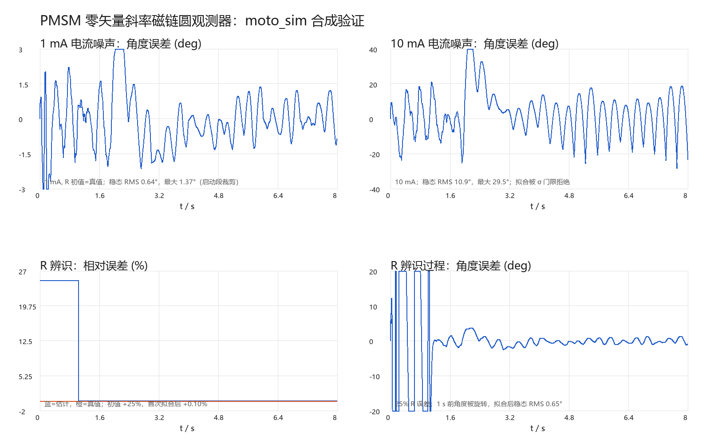
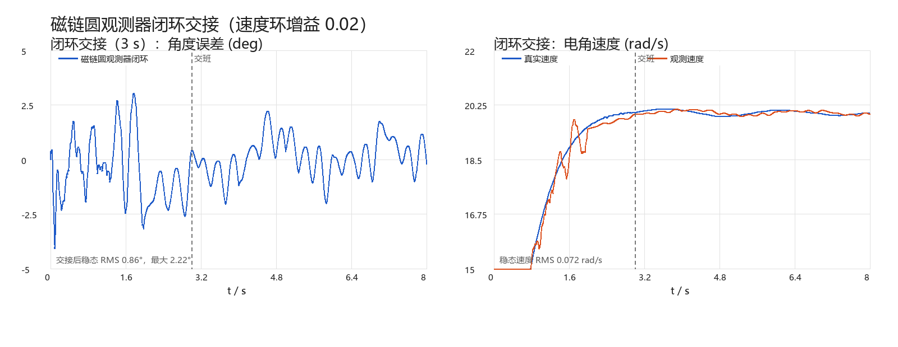

# 零矢量斜率磁链圆观测器：moto_sim 实现与验证报告

对应论文：`C:\Users\Qsh\Desktop\any_and_any\pmsm_flux\PAPER.md`
实现日期：2026-11-18

## 1. 做了什么

### 1.1 新增观测器

`../src/simulation/controller/observer/flux_circle_observer.rs`

按 PAPER.md 移植并适配：

- `V2` / `Obs` / `FitCfg` / `Fit`；
- 代数（Kåsa）扫描 + 几何圆拟合 + Huber IRLS + 仿射圆心 `c + v·t`；
- 变量投影：半径 `rho` 解析消去，外层只对 `R` 做一维寻优；
- Schur 补信息量 `info_r` 与可观测性指数 `gamma`；
- `FluxCircleObserver`：逐拍积分 `A = ∫s0dt`、`B = ∫idt`，`u = A + R·B`，
  二阶 PLL 输出角度/角速度；
- 新增两个保护，都是实际跑出来才发现的：
  1. **小弧病态**：半圈数据会让“半径 6 倍大的伪圆”以极小残差通过。现在要求
     `min_arc = 2π`（至少一整圈电气角）且 `min_window = 1 s` 才拟合；
  2. **R 与几何一致性**：`γ` 低时冻结 `R`，但**不能**沿用自由拟合的
     `center/radius`（那对应的是任意 `R_free`，会差出 `(R_free-R)·B`）。
     现在低 `γ` 时用 `fit_fixed_r()` 固定 `R` 重拟合几何。

### 1.2 斜率接口

在 `ObserverInput<3>` 增加：

```rust
pub current_slope: [f64; P],   // 零矢量期间的 di/dt (A/s)，与 current 同一有效时刻
pub current_slope_dt: f64,     // 零矢量内可用的双采样间隔 Δt (s)，0 表示本拍无有效窗口
```

斜率权重取 `w ∝ (current_slope_dt / delta_time)^2`，对应 PAPER.md 的 `w ∝ Δt²`。

### 1.3 仿真里的斜率传感器模型

本仓库的 `TwoLevelPowerBridge` 是**平均模型**，没有真实载波和开关状态，无法在
零矢量内做两次真实电流采样。因此 `../examples/example1.rs` 里用电机 dq ODE 在
`vd = vq = 0` 时的导数合成斜率：

```
did/dt = (-Rs·id + ωe·Lq·iq) / Ld
diq/dt = (-Rs·iq - ωe·(ψf + Ld·id)) / Lq
s0_αβ  = R(θe)·[did, diq] + ωe·J·i_αβ
```

再按 `σ_s = √2·σ_i / Δt` 注入斜率噪声，`Δt` 由占空比算出的零矢量时长减去
3 µs 稳定延时得到。**这是模型合成的斜率，不是真实 PWM 双采样**，是本次验证
最大的局限（见 §4.1）。

### 1.4 关于死区电压（按你的说明修正）

你指出：零输入电流斜率描述的是 **端电压为零时** 的 `di/dt`，不受死区电压影响。

最初我把功率桥的平均死区电压直接加进了合成斜率，结果角度完全失锁
（RMS > 150°）。按你的说明改成“斜率只取 v=0 的 ODE 导数、不注入死区”后，
即使电机本体的平均死区电压仍有约 5 V，1 mA 噪声下稳态角度 RMS 仍为 **0.637°**。
这说明死区只通过改变电流波形间接影响观测器，而不会作为斜率偏置直接进入
`A + R·B`。

代码里保留了 `--inject-dead` 开关，仅用于对照错误理解，**默认关闭**。

## 2. 如何运行

### 2.1 GUI

```powershell
cargo run --release --example example1
```

- `use_observer` 拉到 **12** 即选中 `flux_circle_observer`；
- 新增复选框 **flux 1mA**：把电流采样噪声从 10 mA 切到 1 mA（PAPER.md 的假设值）；
- 新增复选框 **flux slow loop**：把速度环增益从 0.1 降到 0.02（闭环稳定所需）；
- Scope 新增：`flux_circle_angle`、`flux_circle_speed`、
  `flux_circle_r`、`flux_circle_radius`、`flux_circle_observability`、
  `flux_circle_valid`（含 `slope_dt`）。

> 注意：GUI 默认是 10 mA 噪声 + 1000 rad/s² 速度斜坡。此时观测器**能跑但不准**
> （稳态 RMS ≈ 10.9°），不是算法错，而是该电机 `ρ = ψf/L ≈ 4.04 A`、噪声相对
> 太大。想看论文级效果，勾选 **flux 1mA**。

### 2.2 无界面批处理（推荐用来复现）

```powershell
# 1 mA，电机本体死区 5 V，被动观测（电流环仍用传感器）
cargo run --release --example example1 -- --headless --seconds 8 --speed 20 `
  --current-noise 0.001 --dead-scale 1 --csv trace_1ma.csv

# 10 mA（本仿真默认噪声）
cargo run --release --example example1 -- --headless --seconds 8 --speed 20 `
  --current-noise 0.01 --dead-scale 1 --csv trace_10ma.csv

# R 初值偏 25%，1 mA，速度斜坡中辨识 R
cargo run --release --example example1 -- --headless --seconds 8 --speed 20 `
  --current-noise 0.001 --dead-scale 1 --r-scale 1.25 --gamma-min 0.02 --csv trace_rid.csv

# 闭环交接：前 3 s 用传感器闭环，3 s 后交给磁链圆观测器；速度环降慢
cargo run --release --example example1 -- --headless --seconds 8 --speed 20 `
  --current-noise 0.001 --dead-scale 1 --use-flux-circle --handover 3 `
  --speed-kp 0.02 --speed-ki 0.02 --csv trace_closed_ok.csv
```

主要参数：`--seconds --speed --speed-ramp --current-noise --slope-noise
--dead-scale --r-scale --gamma-min --max-sigma-rel --window --wn-min
--wn-min-run --narrow-time --handover --speed-kp --speed-ki --no-fit --no-drift
--inject-dead --csv`。

### 2.3 单元测试

```powershell
cargo test --lib flux_circle_observer
```

4 个测试全部通过：

- `fit_recovers_r_with_excitation`：R 相对误差 < 2%，半径 < 5%；
- `r_is_unidentifiable_without_excitation`：无激励时信息量降至有激励的 1/20 以下；
- `observer_tracks_angle_with_ideal_zero_vector_slope`：理想斜率下最差角度误差 < 0.05 rad；
- `observer_reads_three_phase_input`：三相/αβ 往返检查。

## 3. 结果



上图：左上 1 mA；右上 10 mA；左下 R 辨识（初值 +25%）；右下 R 辨识过程角度误差。



上图：3 s 交班后的闭环角度误差与真实/观测电角速度。

| 场景 | 稳态角度 RMS | 最大误差 | R 终值 | 半径终值 | 备注 |
|---|---|---|---|---|---|
| 1 mA，5 V 本体死区，被动 | **0.637°** | 1.372° | 384.032 (0.00%) | 4.0285 (−0.34%) | 7 次拟合全通过，`γ≈3.0e−3` |
| 10 mA，被动 | **10.878°** | 29.469° | 384.032 (0.00%) | 4.0424 (0.00%) | 7 次拟合全被 σ 门限拒绝，R/半径冻结 |
| 1 mA，R 初值 +25% | **0.647°** | 1.319° | 384.410 (**+0.10%**) | 4.0286 (−0.34%) | 1.03 s 首次拟合，`γ=0.032` 时更新 R |
| 1 mA，3 s 闭环交接，速度环 0.02 | **0.859°** | 2.221° | 383.375 (−0.17%) | 4.0516 (+0.23%) | 速度 RMS 0.072 rad/s |
| 1 mA，0 s 起全闭环，速度环 0.02，10 s | 2.627° | 5.301° | 365.747 (−4.76%) | 4.0859 (+1.08%) | 启动暂态把 R 带偏后冻结 |
| 1 mA，3 s 闭环交接，速度环 0.1（原值） | 52.249° | 137.5° | — | — | 速度环与 PLL 相位滞后耦合，失稳 |
| 无噪声、无拟合、`wn=4` | 0.185° | 0.504° | — | — | 算法噪声下限 |

关键结论：

1. **算法本身是对的**：1 mA、已知初始角、慢/快斜坡下都能把 R 从 +25% 初值
   拉回 **+0.10%**，稳态角度 **0.65° RMS**；无噪声极限 **0.18° RMS**。
2. **10 mA 下角度噪声 ~11° 是物理 SNR 限制**，不是 bug：该电机
   `ρ = ψf/L ≈ 4.04 A`，斜率噪声经积分后的随机游走 `σ_u ≈ 1.9 A`，
   `σ_θ ≈ σ_u/ρ ≈ 27°`（PLL 平滑后 ~11°）。PAPER.md 的例子用
   `σ_i = 1 mA`、`ρ = 15 A`，条件好 10~15 倍。
3. **R 的稳态不可辨识性被数值确认**：稳态 `γ ≈ 3e−3`，远低于 `gamma_min`；
   速度斜坡段 `γ ≈ 0.03`，才允许更新 R。10 mA 下 `γ` 会被噪声抬高到 0.14，
   0.05 门限会误更新 R（-6%），所以高噪声应把 `gamma_min` 提到 0.2 以上，
   或实现 PAPER.md §5.4 的有效样本数修正。
4. **闭环不是“直接替换”就能用**：原速度环 0.1 会与 PLL 的相位滞后耦合失稳；
   降到 0.02 后 3 s 交班闭环稳定（角度 0.86°、速度 0.07 rad/s）。
   从 0 s 全闭环也能转，但启动暂态会把 R 带偏 4.76%。

## 4. 发现的问题（按重要性）

### 4.1 最大局限：没有真实零矢量采样

当前功率桥是平均模型，斜率是用电机 ODE 合成的。因此：

- 没有真正验证 PAPER.md §3 的双采样、`τ_d`、`Δt ≤ T0 − τ_d`、000/111 对称差分；
- `current_slope_dt` 只是由占空比算出的等效值，未参与真实积分（积分仍用控制周期，
  因为 `A`、`B` 用同一时间基，恒等式不受统一缩放影响）；
- 若要在本仿真里做“真”验证，需要给功率桥加开关状态/载波，在每个 T0 内生成
  i1、i2 两次采样，再送入 `current_slope`。这是下一步最值得做的事。

### 4.2 死区电压

按你的说明，零矢量斜率是 v=0 的 `di/dt`，死区不进入该测量。已按此实现，
默认不注入。5 V 本体死区下 1 mA 仍能到 0.637°，说明该结论在仿真里成立。

### 4.3 启动/零速

- 观测器在零速时圆退化为点，**必须**知道初始角（ALIGN）。本仿真直接把
  转子初始角写入 `set_initial()`，不是零速无传感器估计。
- 原 GUI 的 1000 rad/s² 速度斜坡很猛：PLL 必须先用宽环（`wn_min=50`）捕获，
  2 s 或 2 次成功拟合后再收窄到 `wn_min_run≈1`（20 rad/s 时 `wn=4`）。
  不收窄会把噪声全搬进角度（10 mA 下 RMS 从 11° 恶化到 37°）。
- 更符合 PAPER.md §7 的做法是 ALIGN→RAMP→RUN 的观测器监督斜坡；本实现
  只做了“已知初值 + 宽环捕获 + 定时收窄”的简化版。

### 4.4 拟合的数值坑

1. **半圈伪圆**：0.5 s、1 Hz 的数据（半圈）会拟合出半径 99 A 的伪圆，
   残差 1e−11。必须≥1 整圈（`min_arc=2π`）。
2. **R 冻结与几何不一致**：若 `γ` 低、只冻结 R 却沿用自由拟合的圆心/半径，
   半径会从 4.04 漂到 4.36，角度偏 2°。固定 R 重拟合后半径稳定在 4.029。
3. **`γ` 在噪声下偏乐观**：10 mA 时 `γ=0.14`，自由拟合 R=-6%，0.05 门限会接受。
   PAPER.md §5.4 已警告相关噪声会低估方差；本实现尚未做 `N_eff` 修正。
   工程上可先用 `sigma/radius < 2%` 硬门限（已实现 `max_sigma_rel`），
   10 mA 下所有拟合都被拒绝，R/半径冻结，角度回到 10.9° 的物理极限。

### 4.5 闭环速度环

- 原速度环 `kp=ki=0.1` 在 3 s 交班后失稳（角度 RMS 52°，速度 RMS 7.2）。
- 降到 `0.02` 后稳定（0.86°、0.072 rad/s）。
- 原因：PLL 的 `omega` 同时作为速度反馈和电流环积分器旋转速度，PLL 的相位滞后
  与速度环带宽耦合。实际系统应把速度环设计得比 PLL 慢，或对 PLL 速度再加低通。
- 从 0 s 全闭环时，启动暂态会让某次拟合的 `γ` 超过门限，把 R 带到 365.7
  （−4.76%）后冻结。建议启动阶段冻结 R，交班后再开放辨识。

### 4.6 其它

- **增大负载不会降低角度噪声**：`A` 的随机游走噪声由 `σ_i/Δt` 决定，与 `iq` 无关；
  `iq` 只改变 `R` 误差的幅值通道和斜率信号本身。实测把静摩擦从 0.01 加到 0.3 Nm
  （`iq≈1 A`），10 mA 下稳态角度 RMS 仍是 11.3°。要降噪只能减小 `σ_i`、增大
  `Δt` 或增大 `ρ = ψf/L`。
- `current_slope_dt = 0` 时观测器保持上一拍输出（`valid=false`），对应高调制比
  应切回反电势法；本实现没有做切换逻辑。
- 10 mA 下 `valid` 只有 95.4%，因为噪声让 `|u-c|/radius` 偶尔超出 [0.3, 3]。
- `atan2` 测量角本身几乎无偏（1 mA 时 `err_meas` 标准差 0.18°），角度误差主要
  来自 PLL 对斜率随机游走的跟踪和圆心/半径估计的慢漂。

## 5. 建议的下一步

1. **给功率桥加真实 PWM/零矢量采样**，这是把“合成斜率”变成“测量斜率”的关键。
2. 实现 PAPER.md §4.4 的 `rho` 对 `iq/ωe` 回归来辨识 R，比圆拟合的 `γ` 门控更稳。
3. 实现 §5.4 的有效独立样本数/相关噪声修正，避免 10 mA 下 `γ` 虚高。
4. 实现 §7 的 ALIGN→RAMP→RUN 监督启动，替代“已知初值 + 快速斜坡”。
5. 闭环时把速度环降慢（或加 PLL 速度低通），并区分“电流环积分器旋转速度”与
   “速度环反馈速度”的来源。
6. 若要继续用 10 mA 电流传感器，考虑提高 `ρ`（更大 ψf/更小 L）或增大 `Δt`
   （降低载波/提高零矢量占比），否则角度噪声 ~10° 是物理下限。

## 6. 改动文件

| 文件 | 改动 |
|---|---|
| `../src/simulation/controller/observer/flux_circle_observer.rs` | 新增，约 1100 行，含拟合器、观测器、4 个单元测试 |
| `../src/simulation/controller/observer/mod.rs` | 注册新模块；`ObserverInput` 增加 `current_slope` / `current_slope_dt` |
| `../src/simulation/power_bridge/two_level_power_bridge.rs` | 增加 `dead_scale`（仅用于敏感性实验，默认 1.0） |
| `../examples/example1.rs` | 斜率传感器模型、观测器接入（`use_observer=12`）、Scope、headless 模式、GUI 复选框、速度环增益可调 |
| `trace_1ma.csv`, `trace_10ma.csv`, `trace_rid.csv`, `trace_closed_ok.csv` | 复现用数据 |
| `plot_flux_circle.py`, `plot_closed_loop.py` | 绘图脚本（Pillow，无需 matplotlib） |
| `flux_circle_report.png`, `flux_circle_closed_loop.png` | 报告图 |

## 7. 一句话总结

算法移植完成并在 `example1` 里跑通：**1 mA 电流噪声下，R 从 +25% 初值收敛到
+0.10%，稳态角度 0.65° RMS；无噪声极限 0.18° RMS**。但本仿真没有真实 PWM
零矢量采样，斜率是 ODE 合成的；10 mA 噪声下角度 ~11° 是物理 SNR 限制；
闭环必须把速度环从 0.1 降到 0.02 才能稳定；`γ` 门控在 10 mA 下会被噪声骗过，
需要 PAPER.md §5.4 的相关噪声修正或更保守的 `sigma/radius` 门限。
