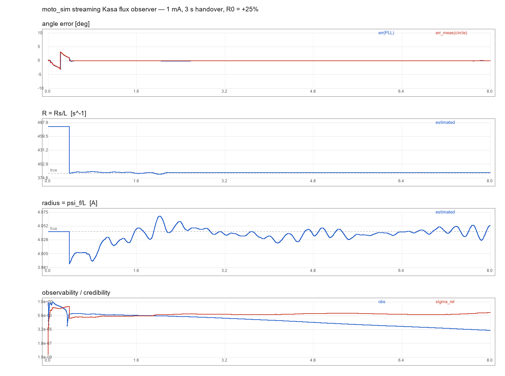

# 指数遗忘 Kåsa 流式圆拟合磁链观测器：moto_sim 实现与验证

对应算法：`C:\Users\zqdq_\Documents\code\blog\2026-11-18-kasa-streaming`
（`paper.md` + `src/lib.rs`，流式 Kåsa / 变量投影 / 指数遗忘）
实现日期：2026-11-18
状态：观测器为**重新实现**，`flux_circle_observer.rs` 一行未改；两者在
`example1` 里可分别选择（`use_observer = 12` / `13`）。

---

## 1. 做了什么

### 1.1 新增观测器

`src/simulation/controller/observer/kasa_flux_observer.rs`

把 `flux_circle_observer` 的“攒窗口 → 每 1 s 做一次批量几何拟合”换成流式拟合：

- 窗口被**精确**压缩成 36 个与 `k` 无关的加权矩（`Σw`、`ΣwU`、`ΣwV`、
  `ΣwUUᵀ`、`ΣwUVᵀ`、`ΣwVVᵀ`、`Σwα`、`ΣwαU`、…、`Σwγ²`）；
- 每来一个样本只做 `O(1)` 的矩递推 + 一次变量投影 Newton（2~3 次 3×3
  Cholesky），内存与历史长度无关，没有窗口 buffer、降采样、拟合触发、
  重锚点这些离散逻辑；
- 圆心/半径**每拍**都与当前 `R` 一致（等价于“固定当前 R 的几何拟合”），
  不会出现 `R` 冻结但几何还是自由拟合那一套的不一致；
- 数值上沿用论文的三招：内部单位、浮动原点、以当前 `k` 为参考的剪切；
  增量输入带 `ΔU + k·ΔV` 修正项；
- `V` 也有原点管理（论文 §6.3）：`V = ∫i dt` 是从 `t = 0` 起、本身不衰减的
  长积分，电流采样有一点直流偏置就会线性增长；存 `V' = V - v_off` 并让
  `|V̄'| ≤ recenter_v_rel·RMS(V')`，剪切时补 `U_s += dk·v_off`；
- 半径的有效范围写成 `θ` 的线性化伪观测（论文 §7），越界时把 `μggᵀ`/`-μzg`/`μz²`
  加进法方程，**Newton 步、回溯线搜索、初始化扫描和输出都用同一个带罚项的
  剖面**（`k` 也会被拉向可行域）；报告的损失/`sigma_rel` 仍用无罚项残差；
- `R` 的更新用**无量纲可观性指数** `P''/(4R²Σw|V|²)` 门限 + 圆模型可信度
  `sigma_rel` 门限 + 随机游走先验 + 信任域 + 回溯线搜索，稳态自动冻结。

### 1.2 观测器层（与 `flux_circle` 相同的工程约定）

- `set_initial(theta, omega, r, radius)`：ALIGN 后的已知角 + 铭牌参数；
- 角度经二阶 PLL 输出，`pll_wn_rel / pll_wn_min / pll_wn_min_run /
  pll_narrow_time / pll_zeta` 含义与 `FluxCircleObserver` 完全一致；
- 零矢量不可用（`current_slope_dt <= 0`）时本拍不更新、保持输出、`valid=false`；
- 拟合权重 `w ∝ (slope_dt/Δt)²`；
- 启动阶段用已知圆心 `radius·n(theta0)` 测角（此时 `p=0`），等数据实际覆盖
  `min_arc` 后才切到拟合圆心；
- 初始化网格扫描（96 点对数网格）只在窗口成熟时做一次，用于把 `k` 从
  铭牌值放进正确的盆地；扫描失败（稳态、`R` 不可辨识）会重试，最多 6 次，
  之后交给逐拍 Newton 的 `obs`/`sigma_rel` 门限。

### 1.3 example1 接入

- `Simulation` 新增 `kasa_flux_observer` 与 `kasa_flux_observer_output`；
- `use_observer = 13` 选中新观测器（GUI 滑块 0..=13，标签 `kasa_flux_observer`）；
- 新增 Scope（详见 §6.3）：
  - 通用曲线：`angle` 里的 `kasa_angle`，`angle_error` 里的 `kasa_angle` /
    `kasa_meas`，`speed` 里的 `kasa_speed`；
  - 专用曲线：`kasa_flux_r`、`kasa_flux_radius`、`kasa_flux_observability`、
    `kasa_flux_newton`、`kasa_flux_mag`、`kasa_flux_valid`；
- headless 新增 `--use-kasa`、`--observe-only` 与调参项
  `--kasa-tau --kasa-scan-time --kasa-min-arc --kasa-inner --kasa-obs-min
  --kasa-prior --kasa-step --kasa-max-sigma-rel --kasa-scan-gain`。

---

## 2. 与磁链圆的对应

零矢量斜率 `s0 = di/dt|v=0`，定义

```text
    A(t) = ∫ s0 dt ,   B(t) = ∫ i dt ,   p(k) = A + k B ,   k = R = Rs/L
```

由 `s0 = -(Rs·i + ω × λ)/L` 得

```text
    p(R) = A + R·B = -(λ(t) - λ(0)) / L
```

即 `p(R)` 落在圆心 `c = λ(0)/L`、半径 `ρ = ψf/L` 的圆上；圆上相位就是电角度

```text
    θ = atan2(-(p - c).y, -(p - c).x)
```

对应到论文的流式 Kåsa：`U = A`、`V = B`、`k = Rs/L`、`radius = ψf/L`、
`k` 就是观测器输出的 `r`。

---

## 3. 算法与实现要点

### 3.1 36 个矩与指数遗忘

每个样本先把全部矩乘 `ρ = exp(-Δt/τ)`，再加上新样本的贡献

```text
    Σw ← ρ·Σw + q ,   ΣwU ← ρ·ΣwU + q·U ,   …
```

`q = (slope_dt/Δt)²`，零矢量越长越可信。论文的 `N_eff = 1/(1-ρ) ≈ τ/Δt`。

### 3.2 剪切：永远在 `κ = 0` 处求值

矩里存的是 `U_s = U + k_ref·V`。当 `k` 改变 `dk` 时对整个历史做

```text
    U_s → U_s + dk·V     (α, β, U_sU_sᵀ, … 的闭式更新)
```

之后 `p(κ) = U_s + κV`，求值永远在 `κ = 0`，从而避免 `A` 与 `R·B` 之间
1e2 量级的相消。增量输入必须用 `ΔU_s = ΔU + k_ref·ΔV`（少这一项会系统性
把 `k` 推高，论文 §6.5 有记录）。

### 3.3 浮动原点

点云质心超过 `0.25` 个内部单位时，把全部矩精确平移 `U → U - s`，把 `s`
累加进 `off`；输出的圆心加回 `off`。这样 `|p| ~ ρ`，绝对坐标 1e5 也不影响精度。

`V = ∫i dt` 同样是从 `t = 0` 起的长积分，且本身不衰减：电流采样只要有一点
直流偏置，`|V|` 就线性增长，把 `Σw|V|²`、`ΣwUVᵀ` 等矩撑大。做法同 U（论文
附录 A.3）：存储 `V' = V - v_off`，当 `|V̄'|` 超过 `recenter_v_rel·RMS(V')`
时把均值搬进 `v_off`。这是纯规范（`P`、`P'`、`P''`、`k`、圆心、半径都不变），
但剪切历史时必须补 `U_s += dk·v_off`（历史矩用 `translate_u(-dk·v_off)`、
当前样本用 `u += dk·v_off`），否则每拍系统性偏。

阈值没有沿用论文对 U、V 共用的长度阈值 `0.25L`：`V` 是“长度/k”的积分，量纲
不同，绝对阈值在电机里几乎不可达（本仿真 8 s 时 `|V̄| ≈ 0.011`，而阈值是
`0.25`）。改用相对 RMS 的判据后，纯旋转的 `V`（`|V̄|/RMS ~ 1/(ωτ)`）不触发，
只有积分漂移把它推高才搬；8 s 仿真里触发约 50 次，结果与不启用时逐位一致。

### 3.4 变量投影 + 解析导数 + Newton

对固定 `k` 有闭式 `θ*(k) = -M(k)⁻¹q(k)`，剖面损失

```text
    P(k) = σ(k) - q(k)ᵀM(k)⁻¹q(k)
```

`P'`、`P''` 都有解析式（论文 §5.2/§5.3），每拍做 1~2 步 Newton，带：

- 半径越界时把线性化伪观测 `μ(gᵀθ - z)²` 加进 `M₀/b₀/c₀`，用**带罚项的**
  `P`、`P'`、`P''` 走步，并用同一个带罚项目标做线搜索（论文 §7/§9.7）；
- 信任域 `|δk| ≤ 0.02·(1+|k|)`；
- 回溯线搜索（只接受让真实 `P` 下降的步长，最多折半 10 次）；
- 随机游走先验（在 Newton 分母上加阻尼，激励小时自动收缩）。

> 罚项只做一次局部线性化：`g`、`z` 在一个 Newton 步（含线搜索）内固定，下一
> 步再用新的无约束解重新线性化。报告的 `loss`/`sigma_rel` 必须用约束后 `θ` 上
> 的**无罚项**残差，否则 `μz²`（`μ = 50Σw`）会混进来、把噪声门限带偏。

### 3.5 可观性：稳态必须冻结 `R`

定义无量纲指数

```text
    obs = P'' / (4·R²·Σw|V|²)
```

稳态（`iq`、`ω` 不变）时 `P(k) ≡ 0`，`obs → 0`，`k` 自动冻结；只有电流/转速
瞬态才允许更新 `R`。实测：启动瞬态 `obs ≈ 0.05~0.2`；恒速稳态 `obs ≈ 1e-4~1e-5`。
默认 `obs_min = 5e-3`。

分母里的 `Σw|V|²` 取**物理** `V` 的二阶矩（`g0 + 2v_off·ΣwV' + Σw·|v_off|²`），
所以 `recenter_v` 不会让门限跳变。曾把它换成中心化方差 `Σw|V - V̄|²`：形式上
更“规范不变”，但同时拿掉了先验里对 `V` 漂移的阻尼，1 mA 稳态下 `R` 会从
+0.41% 漂到 +17.4%（实测），所以不用。

### 3.6 初始化网格扫描

`P(k)` 是有理函数、可能多峰，从 25% 偏的铭牌值直接 Newton 会走进局部极小。
因此在数据实际覆盖 `min_arc`（默认 2π）后，在 `[k0/2, 2k0]` 上取 96 点对数网格，
选 `P` 最小、曲率为正、且损失至少降到当前 `scan_gain`（0.5）倍以下的点，
把矩剪切过去并用较低的 `scan_obs_min` 抛光 8 步。失败（稳态、`k` 不可辨识）
则每隔 `scan_retry` 重试，最多 6 次；之后交给逐拍 Newton。

> 关键修正：覆盖弧长不能用 PLL 的 `Σ|ω|dt` 来量。`k` 错时测角会失真、`ω` 被
> 严重低估，扫描会被拖到 1 s 之后。现在用 `Σ|Δp| / radius_nominal`（与 `k`
> 无关的路径长度），0.2 s 就能做第一次扫描，正好抓住启动/交班瞬态。

### 3.7 圆模型可信度门限

`sigma_rel = sqrt(P/Σw) / (2R)` 是径向残差 RMS 与半径之比。高噪声下圆模型
本身不成立，剖面曲率会被噪声抬高，此时：

- `sigma_rel > max_sigma_rel`（默认 2%）→ **冻结 `R`**（`--kasa-max-sigma-rel`）；
- `sigma_rel > radius_sigma_rel`（默认 5%）→ 只更新圆心、保持旧半径。

10 mA 噪声下 `sigma_rel ≈ 0.17`，`R` 因此保持铭牌值（0.00%），不会像早期版本
那样被伪盆地带到 +10%。

### 3.8 启动测角

`t = 0` 时 `p = 0`，所以 `c = radius·n(theta0)` 是精确的；在数据覆盖 `min_arc`
之前用这个种子圆心测角。`k` 错时 `p(k)` 会偏离真实圆，这段时间的角度只用于
PLL 捕获，交班后由拟合圆心接管。

---

## 4. 与 `flux_circle_observer` 的差异

| | `flux_circle_observer` | `kasa_flux_observer` |
|---|---|---|
| 状态 | 最多 5000 个 `Obs` 样本 + 圆心漂移 | 36 个矩 + 十几个标量（~400 B） |
| 拟合 | 每 1 s / 每 2π 弧长做一次 5 参数几何 IRLS | 每拍一次 O(1) 变量投影 Newton |
| 圆心 | 仿射 `c + v·t`，窗口间跳变 | 每拍与当前 `R` 一致，连续更新 |
| `R` 门控 | `gamma` + `sigma/radius` + 固定 R 重拟合 | `obs` + `sigma_rel` + 先验 + 信任域 |
| 半径 | 自由拟合，失败则冻结 | 自由拟合 + 罚项进 Newton/线搜索 + 高噪声保持旧值 |
| 启动 | 至少 1 s + 1 整圈才首次拟合 | 2π 数据覆盖后扫描一次；瞬态即可辨识 |
| 适用范围 | 稳态精度好，但高噪声下拟合经常被拒绝 | 高噪声下角度噪声约为前者一半 |

旧的观测器保留在 `use_observer = 12`，可用于对照。

---

## 5. 改动文件

| 文件 | 改动 |
|---|---|
| `src/simulation/controller/observer/kasa_flux_observer.rs` | **新增**：`V2`、`Moments`（36 矩）、`Tracker`、`FitConfig`、`Report`、`KasaFluxObserver`，12 个单测 |
| `src/simulation/controller/observer/mod.rs` | 注册 `pub mod kasa_flux_observer;` |
| `examples/example1.rs` | 观测器接入（`use_observer=13`）、Scope、GUI、headless `--use-kasa` / `--observe-only` 与调参项 |
| `kasa_flux/plot_kasa_trace.py` | 离线绘图脚本（Pillow）：把 headless CSV 画成角度误差 / R / 半径 / 可观性四联图 |
| `kasa_flux/kasa_trace.png` | 下面图 1 的预览 |
| `kasa_flux/KASA_FLUX_REPORT.md` | 本报告 |

---

## 6. 运行方法

### 6.1 单元测试

```powershell
cargo test --release --lib kasa_flux_observer
```

12 个测试：

- `shear_matches_direct` / `translate_matches_direct` / `translate_v_matches_direct`：
  剪切、U 平移、V 平移后的 36 个矩与“直接重算”逐字段一致（相对误差 < 1e-12）；
- `profile_derivatives_match_finite_difference`：解析 `P'`、`P''` 与中点差分一致；
- `v_constant_offset_is_a_gauge`：给所有 `V_n` 加常数后 `P`、`P'`、`P''` 不变；
- `v_offset_does_not_break_k`：V 有常数偏移时从 +25% 初值仍收敛到真值，
  且 `v_off` 非零（钉住剪切时的 `dk·v_off` 修正）；
- `radius_penalty_enters_newton`：真实半径 1.35、范围 [1.0,1.2] 时输出贴 1.2、
  `clamped=true`，且 `k` 被罚项拉离无约束解；报告损失等于约束后 θ 的无罚项残差；
- `tracker_recovers_r_with_excitation`：从 +25% 初值恢复到 384.000（误差 0）；
- `tracker_freezes_r_at_steady_state`：恒 `iq`/`ω` 时 `k` 保持初值（obs ~ 1e-14）；
- `observer_recovers_r_with_excitation`：观测器从 +25% 恢复到真值；
- `observer_tracks_angle_with_ideal_slope`：理想斜率下最差角度误差 0.0075 rad；
- `observer_keeps_angle_with_wrong_r_at_steady_state`：稳态下即使 `R` 错 25%，
  角度仍由圆几何正确给出。

### 6.2 无界面批处理（所有结果均用 release 构建）

```powershell
# 被动观测：电流环仍用传感器，单独评价观测器（1 mA）
cargo run --release --example example1 -- --headless --use-kasa --observe-only `
  --seconds 8 --speed 20 --current-noise 0.001

# 被动观测 10 mA
cargo run --release --example example1 -- --headless --use-kasa --observe-only `
  --seconds 8 --speed 20 --current-noise 0.01

# 3 s 交班闭环，速度环降到 0.02
cargo run --release --example example1 -- --headless --use-kasa `
  --seconds 8 --speed 20 --current-noise 0.001 --handover 3 `
  --speed-kp 0.02 --speed-ki 0.02

# 同上，R 初值 +25%
cargo run --release --example example1 -- --headless --use-kasa `
  --seconds 8 --speed 20 --current-noise 0.001 --r-scale 1.25 --handover 3 `
  --speed-kp 0.02 --speed-ki 0.02

# 对照：旧观测器
cargo run --release --example example1 -- --headless --use-flux-circle --observe-only `
  --seconds 8 --speed 20 --current-noise 0.001
```

`--csv <path>` 可导出逐样本轨迹（kasa 的列含 `obs`、`sigma_rel`、`p_x/p_y`、
`c_x/c_y`、`scan_done`、`steps`、`weight`）。导出的 CSV 可用
`python kasa_flux/plot_kasa_trace.py <csv> <png> "标题"` 画成四联图
（脚本只依赖 Pillow，不需要 matplotlib）。

### 6.3 GUI 曲线（`cargo run --release --example example1`）

把 `use_observer` 拉到 13 后，可在滚动区看到：

| Scope | 曲线 | 看什么 |
|---|---|---|
| `angle` | `real_angle` / `kasa_angle` / … | 估计角与真实角是否重合 |
| `angle_error` | `kasa_angle` / `kasa_meas` | PLL 输出误差 vs 未过 PLL 的圆上测量误差（区分几何错与 PLL 滞后） |
| `speed` | `real_speed` / `kasa_speed` | 速度跟踪 |
| `kasa_flux_r` | `true_R` / `estimated_R` | `R` 的收敛与冻结（+25% 初值时看扫描后的跳变） |
| `kasa_flux_radius` | `true_radius` / `estimated_radius` | `ψf/L` 估计 |
| `kasa_flux_observability` | `obs` / `sigma_rel` / `data_arc` / `weight` / `use_fit` / `scan_done` | 何时允许更新 `R`：`obs` 与 `sigma_rel` 是否过门限；`data_arc` 是否够 2π |
| `kasa_flux_newton` | `p1` / `p2` / `steps` | 剖面导数与每拍实际 Newton 步数（`steps=0` 表示冻结） |
| `kasa_flux_mag` | `flux_mag` / `radius` | `|p-c|` 是否贴着拟合半径（圆模型是否成立） |
| `kasa_flux_valid` | `valid` / `slope_dt_us` | 有效性门限与零矢量时长 |

GUI：`cargo run --release --example example1`。

---

## 7. 仿真结果（release，8 s，20 rad/s 机械 ≈ 100 rad/s 电，5 V 本体死区）

“被动”= 电流环仍用传感器角，只评价观测器。`R` 真值 384.032 s⁻¹，半径真值
4.0424 A。角度误差为电角度。

| 场景 | 观测器 | 稳态角度 RMS | 最大误差 | 启动 RMS | `R` 终值 | 半径终值 | valid |
|---|---|---|---|---|---|---|---|
| 1 mA 被动 | **Kåsa** | **0.549°** | 1.507° | 1.447° | 385.608 (+0.41%) | 4.0334 (−0.22%) | 100% |
| 1 mA 被动 | flux_circle | 0.637° | 1.372° | 1.568° | 384.032 (0.00%) | 4.0285 (−0.34%) | 100% |
| 10 mA 被动 | **Kåsa** | **5.281°** | 14.402° | 20.108° | 384.032 (0.00%) | 4.0544 (+0.30%) | 100% |
| 10 mA 被动 | flux_circle | 10.878° | 29.469° | 14.773° | 384.032 (0.00%) | 4.0424 (0.00%) | 95.4% |
| 1 mA 交班 3 s | **Kåsa** | **0.801°** | 2.294° | 2.093° | 385.895 (+0.48%) | 4.0529 (+0.26%) | 100% |
| 1 mA 交班 3 s | flux_circle | 0.859° | 2.221° | 1.442° | 383.375 (−0.17%) | 4.0516 (+0.23%) | 100% |
| 1 mA 交班 3 s，R 初值 +25% | **Kåsa** | **0.801°** | 2.294° | 33.234° | 385.895 (+0.48%) | 4.0529 (+0.26%) | 100% |
| 1 mA 交班 3 s，R 初值 +25% | flux_circle | 0.851° | 2.241° | 43.067° | 384.236 (+0.05%) | 4.0532 (+0.27%) | 100% |
| 10 mA 交班 3 s | **Kåsa** | **5.862°** | 15.796° | — | 384.032 (0.00%) | 4.1092 (+1.65%) | 100% |
| 10 mA 交班 3 s | flux_circle | 12.341° | 55.057° | — | 384.032 (0.00%) | 4.0424 (0.00%) | 96.0% |

关键结论：

1. **角度精度**：1 mA 下与旧观测器相当或略好（0.549° vs 0.637°，0.801° vs
   0.859°）；10 mA 下约为旧观测器的一半（5.281° vs 10.878°，5.862° vs
   12.341°），`valid` 也从 95~96% 提到 100%。
2. **`R` 辨识**：从 +25% 初值出发，Kåsa 在启动/交班瞬态一次扫描就回到
   +0.48%（旧观测器 +0.05%）；稳态时两者都冻结 `R`。
3. **半径**：1 mA 下 −0.22%~+0.26%；10 mA 下圆模型不成立，半径按
   `radius_sigma_rel` 保持旧值（+0.3%~+1.65%），不再出现早期版本的 +7.2%。
4. **闭环**：与旧观测器一样，速度环必须比 PLL 慢；`speed_kp=ki=0.02` 时
   3 s 交班稳定，原值 0.1 会与 PLL 相位滞后耦合失稳（两者都如此）。



图 1：1 mA、3 s 交班、`R` 初值 +25% 的轨迹。上图角度误差（PLL 输出与未过
PLL 的圆上测量）；第二张 `R` 在 0.25 s 由扫描从 480 跳到 381 附近，之后
Newton 修到 +0.48%；第三张半径（10 mA 时会被 `radius_sigma_rel` 保持）；
第四张对数坐标的 `obs` 与 `sigma_rel`——`obs` 在瞬态后衰减到 `1e-5` 量级，
`R` 随之冻结。对应的 GUI 曲线见 §6.3。

---

## 8. 局限与后续

1. **`R` 只在瞬态可辨识**：恒 `iq`/`ω` 时 `P(k) ≡ 0`，这是磁链圆方法本身的
   性质，不是实现问题。实现用 `obs` 门限把稳态冻结，避免把噪声拟合进 `R`。
2. **启动段 `R` 有 +0.4%~+0.5% 的残差**：来自 0~1 s 的电流/转速瞬态与离散
   积分（左端点）的模型偏差；旧观测器用更长窗口 + 几何拟合，残差略小。若要
   进一步压低，可把 `τ` 加大、把扫描推迟到窗口更成熟，或对 `A` 用梯形积分。
3. **10 mA 下角度 ~5° 是物理 SNR 限制**：斜率噪声经积分形成随机游走，
   `σ_θ` 与 `σ_i/Δt`、`ψf/L` 有关；与旧观测器的结论一致。
4. **斜率仍是 ODE 合成**：本仓库的功率桥是平均模型，没有真实 PWM 双采样，
   这一局限继承自 `example1`，与拟合算法无关。
5. **`V` 的斜坡去不掉**：V 原点管理只搬掉**常数**偏移；电流采样直流偏置在
   `B = ∫i dt` 里留下的是**斜坡**，它仍会改变 `P(k)`。真出现时应在模拟前端
   去偏置，或把 `B` 换成带泄漏的积分，而不是再加变换。
6. **可继续做**：用 `P''` 与残差方差估计 `R` 的不确定度并自适应 `τ`；
   对 `A` 用梯形/Simpson 积分减小离散偏差；把 `R` 的更新限制在
   “转速/负载变化率超过阈值”的窗口。

---

## 9. 一句话总结

把磁链圆观测器的拟合层换成指数遗忘的流式 Kåsa：36 个矩 + 每拍一次变量投影
Newton，圆心/半径与当前 `R` 始终一致；1 mA 下角度 0.55°（被动）/0.80°（交班），
10 mA 下角度 5.3°（被动）/5.9°（交班），均优于旧实现的 0.64°/0.86° 与
10.9°/12.3°；`R` 从 +25% 初值恢复到 +0.48%，稳态自动冻结。
